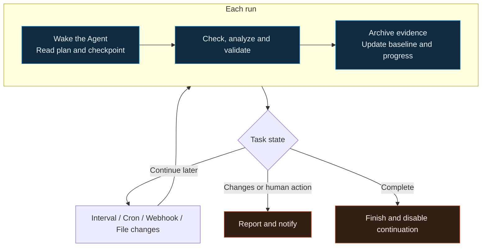

<p align="center">
  
</p>

<h1 align="center">ArgusAI</h1>

<p align="center">
  <strong>Give the Agent a goal. Let it do the work in ArgusAI.</strong><br>
  Local workspace · Long autonomous runs · Proactive defense · Continuous security exercises
</p>

<p align="center">
  
  
  
  <a href="LICENSE"></a>
</p>

<p align="center">
  <a href="wiki/Home.md"><strong>Documentation (中文)</strong></a> ·
  <a href="#quick-start">Quick start</a> ·
  <a href="#continuing-execution-and-proactive-discovery">Automation</a> ·
  <a href="https://github.com/HG-ha/Argusai/releases">Releases</a> ·
  <a href="README.md">简体中文</a> ·
  <a href="https://dawahezhi.com/">Website</a>
</p>

## Agent across the workbench

ArgusAI is an Agent-native security workbench open-sourced by [DAWA Technology](https://dawahezhi.com/) (达瓦科技). It puts an AI assistant, scan tasks, browsers, proxy traffic, reverse engineering samples and evidence in a local workspace, supporting internal-network defense, application defense, attack tracing and continuing security exercises through material review, controlled validation, reporting and remediation testing.

Give the Agent the goal, materials and authorized scope. It organizes scanning, browser, proxy, reverse engineering, knowledge and scheduled tasks, continuing through analysis, validation and delivery. The Agent is the default entry point for work; feature pages let you observe progress, inspect evidence and intervene when needed. The GUI, CLI and Python core connect to the same application capabilities.

The full conversation entry in the sidebar and the movable floating button both open the same Agent workspace. The Agent understands the current application page, the task or reverse job being viewed, and related work state. Reference specific materials so it can continue the work in front of you. Feature pages and conversations share the same tasks, samples and evidence.

The project is intended for internal security teams, application security engineers, researchers and explicitly authorized testers. Its general Agent runtime also supports file processing, routine information work and desktop collaboration; the built-in tools and workflows currently focus on security analysis and reverse engineering.

## One workspace for analysis and execution

<table>
<tr>
<td width="50%" valign="top">
<h3>Conversations, floating entry and teams</h3>
<p>Supports autonomous execution on the scale of tens of hours within one Agent turn, combining tool use, Skills, plans and todos with context compaction, evidence archives and progress checks.</p>
<p>Persistent teams divide work by role, model and tool scope.</p>
<p>The conversation menu and floating button open the same Agent workspace. The button shows running and unread states; expand it to continue a conversation, review tool steps and handle confirmations. Each conversation saves its own model and auto-approval state.</p>
<a href="wiki/Agent-and-Sessions.md">Agent entry points, teams and session settings →</a>
</td>
<td width="50%" valign="top">
<h3>Durable tasks and discovery</h3>
<p>Interval, Cron, signed Webhook and file-change triggers, running in a new conversation, a job-owned conversation or an existing one.</p>
<p>Resume from checkpoints, schedule patrols, compare baselines and report changes.</p>
<a href="wiki/Automation.md">Scheduling, continuation and patrols →</a>
</td>
</tr>
<tr>
<td width="50%" valign="top">
<h3>Web auditing and traffic</h3>
<p>Built-in web checks, live browser viewing and takeover, raw requests and replay; HTTP/1.1 and HTTP/2 MITM, WebSocket capture, breakpoints and optional rewrites.</p>
<p>Import HAR and Burp logs to bring existing materials into an investigation.</p>
<a href="wiki/Web-Audit-and-Proxy.md">Scans, browser and proxy →</a>
</td>
<td width="50%" valign="top">
<h3>Reverse engineering workspace</h3>
<p>Organize JS, WASM, APK, IPA, PE, ELF and HAR in ReverseJobs, linking triage, extraction, decompilation, dynamic observations and evidence.</p>
<p>Connect external tools such as JADX, APKTool, Ghidra, Frida, capa and yara as needed.</p>
<a href="wiki/Reverse-Workbench.md">Samples and reverse tasks →</a>
</td>
</tr>
<tr>
<td width="50%" valign="top">
<h3>Evidence, memory and knowledge</h3>
<p>Link Cases, Artifacts, Evidence and findings. Session memory, knowledge and large-output archives support review and continued work.</p>
<p>Export scan reports as HTML, Markdown and JSON for your deliverables.</p>
<a href="wiki/Enterprise-Workflows.md">Enterprise workflows and outputs →</a>
</td>
<td width="50%" valign="top">
<h3>Tools and extensions</h3>
<p>Python Checks, Agent Tools, Markdown Skills, MCP, local ACP agents, paired messaging channels and desktop automation.</p>
<p>Orchestrate external scanners and specialist workflows for cloud, IaC, SBOM, offline traffic and firmware.</p>
<a href="wiki/Integrations.md">Integrations and tool dependencies →</a>
</td>
</tr>
</table>

Describe a goal in the full conversation or through the floating entry, such as “Continue the current application audit, refine the plan, advance the analysis within scope, and preserve evidence.” The Agent organizes tool execution around the task. Open feature pages to inspect progress and results; when more material is needed, drag a sandbox file onto the floating button to reference it in the conversation and continue.

Built-in checks, skill-guided workflows and external integrations handle different parts of the process. The [Wiki manual](wiki/Home.md) describes their inputs, dependencies and usage. The Wiki's primary documentation is in Chinese; this page provides the English project overview and quick start.

## Continuing execution and proactive discovery

### Autonomous turns spanning tens of hours

ArgusAI supports autonomous execution on the scale of tens of hours within a single Agent turn. A turn is one user task containing repeated model and tool calls, not one HTTP or model request. The runtime has no fixed model/tool round-count ceiling. Its default emergency wall-clock limit is 7 days, with progress checks, loop detection, cancellation and deadline handling retained.

This is a runtime configuration and control-flow capability. Actual duration depends on the task, model quota, tools, resources and authorization. Long investigations, sample batches and multi-stage validation can progress within one turn; durable tasks and the scheduler carry work across turns or resume it on a later event.

### Cross-turn continuation and events

The Agent stores progress in todos, checkpoints, knowledge and artifacts. The scheduler reconnects that work on the next trigger.

<div align="center">



</div>

| Trigger | Useful work |
| --- | --- |
| Fixed interval `interval` | Periodic patrols, background scan progress, new traffic review |
| Calendar rule `cron` | Daily asset review, weekly exposure checks, scheduled briefings |
| Signed event `webhook` | Follow-up on test builds, external alerts or other process events |
| File changes `file_change` | Analyze changes in logs, reports or a sample directory |

Choose the execution destination independently of the trigger:

| Destination | How context continues |
| --- | --- |
| New conversation per run `new_session` | Separate transcripts; task context, knowledge and artifacts carry required state |
| Job-owned conversation `dedicated_session` | The task accumulates records across runs in its own conversation |
| Existing conversation `session` | Continue with that conversation's history, todos and checkpoints |

Long tasks can use `max_runs=0` to run without a fixed execution-count limit. Each turn reads checkpoints, performs the next step and saves state. This durable, segmented continuation, together with context compaction and evidence archives, supports long investigations, recurring patrols and multi-stage work. The scheduler, models and tools must remain available; information, resources and authorization still determine whether each turn can proceed.

<details>
<summary><strong>Example tasks: patrols and change notifications</strong></summary>

> Review the authorized test services each day during the agreed window, following the procedure stored in the knowledge base. Compare previous records for new assets and configuration changes, and preserve evidence. Stay quiet when nothing changes. Notify me about new risks, execution failures or required human action. Do not rewrite traffic, remediate systems or expand scope.

> Continue the unfinished analysis in this conversation. Read the todos and latest checkpoint first, avoid repeating completed steps, and save progress each turn. Report what is missing when you need input from me. When the work is complete, stop continuation and organize the conclusions.

</details>

The [automation manual](wiki/Automation.md) covers triggers, destinations, run counts and notification policies.

## Enterprise workflows

| Work area | Inputs and process | Work materials |
| --- | --- | --- |
| Internal-network defense | Define authorized IP/CIDR, host and SSH scope; discover assets and analyze service exposure. On hosts with configured SSH, read listening ports, firewall summaries, failed logins and critical service versions, then compare baselines | Asset coverage, exposure changes, risk priorities, hardening recommendations and raw evidence references |
| Application defense | Combine staging targets, test identities, API materials, HAR/JS and business logs with web checks, browser and proxy analysis; review configuration, authentication, access control and unusual requests, then test remediation | Interface and risk inventories, reproducible requests, request/response evidence, remediation guidance and retest records |
| Attack tracing | Review business logs, host audit, proxy traffic and supplied WAF/EDR/SIEM alerts within a selected time window; correlate timestamps, accounts, IPs, processes and request identifiers to test hypotheses | Event timelines, evidence relationships, observed facts versus inferences, confidence and evidence gaps; attribution follows the available evidence |
| Continuing security exercises | Within authorized assets and agreed labs, combine long Agent turns, periodic jobs and event triggers to connect exposure discovery, separately authorized controlled validation, detection evidence review and remediation testing | Exercise chains, detection coverage and gaps, change notifications, review materials and reusable skills and defensive check procedures |

Alerts and remote state come from materials supplied by the user or configured tools, with checks and validation organized within the authorized scope. The responsible team reviews vulnerability conclusions, risk acceptance, production changes and incident response decisions. See [enterprise workflows](wiki/Enterprise-Workflows.md) for inputs, review points and deliverable organization.

## Quick start

The current version is `0.1.0`. Source execution needs Python 3.12+, uv, Node.js 18+ and npm. From the repository root:

```sh
uv sync --locked
npm --prefix argusai/webui ci
npm --prefix argusai/webui run build
uv run argusai --gui
```

On first launch, configure the AI endpoint, model and data directory in Settings, then check browser and external tool paths as needed. Open the full Agent conversation or floating entry and give the Agent the goal, materials and constraints so it can plan and start work. For a first task, provide an approved HAR or JS file and ask the Agent to inventory interfaces, identify leads and archive evidence, then inspect the results on the relevant feature pages.

| Entry point | Start with | Read next |
| --- | --- | --- |
| Full Agent conversation | Open or create a conversation from the sidebar, then give the Agent a goal to execute | [Agent and sessions](wiki/Agent-and-Sessions.md) |
| Agent floating button | Continue current work from a feature page; drag to reposition and check running/unread indicators | [Floating entry and workbench assistance](wiki/Agent-and-Sessions.md) |
| Launch the desktop | `uv run argusai --gui` | [Quick start](wiki/Quick-Start.md) |
| Interactive terminal | `uv run argusai` or `uv run argusai chat` | [CLI reference](wiki/CLI-Reference.md) |
| Release package | Download the published package and `.sha256` from [Releases](https://github.com/HG-ha/Argusai/releases) | [Installation](wiki/Installation.md) |

Windows needs WebView2 Runtime; Windows ARM64 also needs the native Microsoft .NET Desktop Runtime. macOS desktop automation requires system permissions. Linux needs GTK and WebKitGTK desktop libraries. External models, scanners, reverse CLIs and devices are prepared for the features you use; see [installation](wiki/Installation.md).

<details>
<summary><strong>Build, development and release</strong></summary>

All three platforms use the Python build entry point. Run on the target system with an environment for the target architecture:

```sh
uv run --locked --group build python build.py --help
uv run --locked --group build python build.py --dry-run
uv run --locked --group build python build.py --jobs 2
```

Use `--nsis` on Windows, `--dmg` on macOS or `--onefile` for a single executable. Linux also creates a release archive. [Build and release](wiki/Build-and-Release.md) covers dependencies, signing, checksums and the GitHub Actions workflow.

Read [AGENTS.md](AGENTS.md) for development rules and [architecture and development](wiki/Architecture-and-Development.md) for extension points. Run tests with `uv run pytest`, and use `npm --prefix argusai/webui run dev` for frontend development.

</details>

## Documentation map

The linked Wiki pages below are primarily in Chinese.

<table>
<tr>
<td width="33%" valign="top">
<h3>Get started</h3>
<p><a href="wiki/Quick-Start.md">Quick start</a><br><a href="wiki/Installation.md">Installation</a><br><a href="wiki/Agent-and-Sessions.md">Agent, conversations and teams</a><br><a href="wiki/CLI-Reference.md">CLI reference</a></p>
</td>
<td width="33%" valign="top">
<h3>Do the work</h3>
<p><a href="wiki/Automation.md">Scheduling, continuation and patrols</a><br><a href="wiki/Web-Audit-and-Proxy.md">Web auditing and proxy</a><br><a href="wiki/Reverse-Workbench.md">Reverse workbench</a><br><a href="wiki/Enterprise-Workflows.md">Enterprise workflows</a></p>
</td>
<td width="33%" valign="top">
<h3>Configure and extend</h3>
<p><a href="wiki/Integrations.md">Models, tools and integrations</a><br><a href="wiki/Data-and-Safety.md">Data and scope of use</a><br><a href="wiki/Troubleshooting.md">Troubleshooting</a><br><a href="wiki/Build-and-Release.md">Build and release</a></p>
</td>
</tr>
</table>

## Data and scope of use

Sessions, tasks, knowledge, reverse artifacts and logs are stored under the configured data directory. AI requests go to user-configured services; search, downloads, messaging and out-of-band verification may also contact external services. Session file and runtime separation organizes execution; actual access remains subject to tool authorization and host permissions.

Use ArgusAI on systems you own, explicitly authorized assessments and isolated labs. Establish authorization for targets, methods, time windows and impact. Review model conclusions and assess active scans, traffic rewrites, dynamic instrumentation and production schedules. See [data and scope of use](wiki/Data-and-Safety.md).

## License

Except for third-party content with separate notices, ArgusAI is licensed under [GNU GPL version 3 only](LICENSE) (`GPL-3.0-only`). Later versions are not automatically permitted. Individuals and businesses may use, modify and commercially use it under this license; business use does not require a separate software license purchase.

When distributing the program or a combined work covered by the GPL, provide the Corresponding Source, preserve copyright and license notices, and meet the other applicable GPLv3 conditions. See [LICENSE](LICENSE) for the complete terms.

Bundled third-party components retain their own licenses; see [THIRD_PARTY_NOTICES.md](THIRD_PARTY_NOTICES.md) for their scope and notices. DAWA Technology may provide paid deployment, integration, customization and technical support services. These services do not change the rights granted by the GPL.

## Participate

Contribute reproducible issues, tool adapters, checks, Skills or interface improvements. Include the version, operating system, reproduction steps and redacted logs. Preserve third-party tool and vendor license notices.

Contributions use the license applicable to the relevant files: `GPL-3.0-only` for project code and the original licenses for third-party content. Contributors retain their copyright.

[Report an issue](https://github.com/HG-ha/Argusai/issues) · [Development rules](AGENTS.md) · [Architecture](wiki/Architecture-and-Development.md) · [Wiki maintenance](wiki/Wiki-Maintenance.md)

<p align="center">Open-sourced by <a href="https://dawahezhi.com/">DAWA Technology</a> (达瓦科技) · <a href="https://github.com/HG-ha/Argusai">HG-ha/Argusai</a></p>
