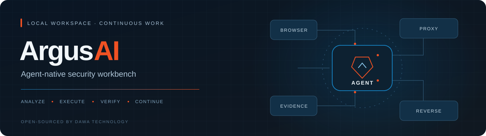
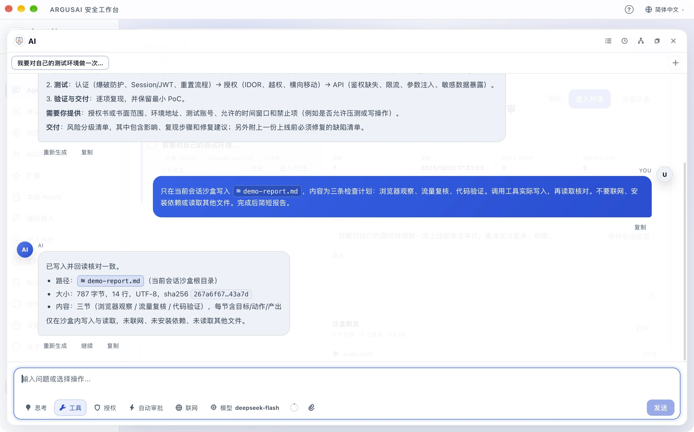
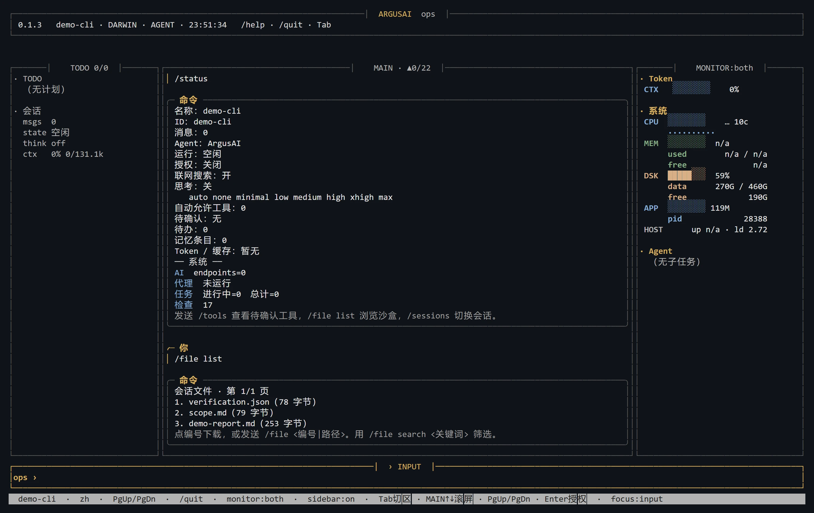
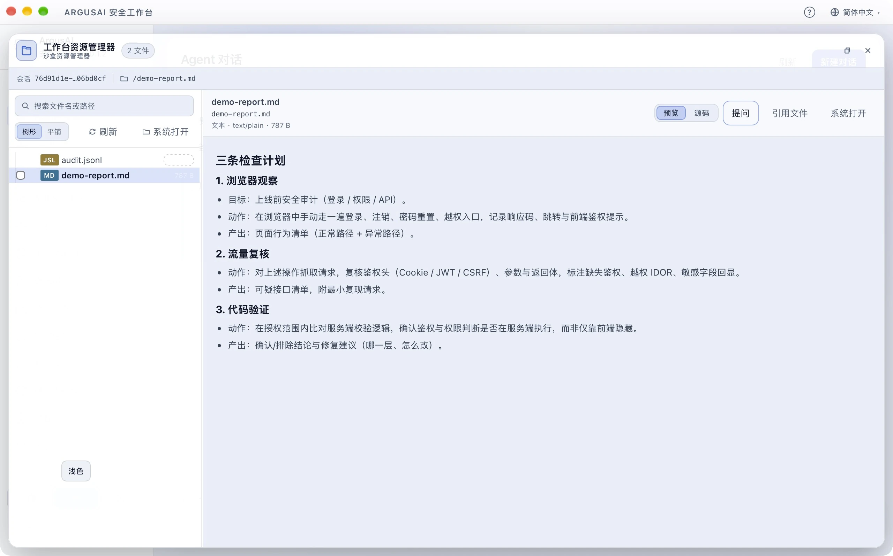
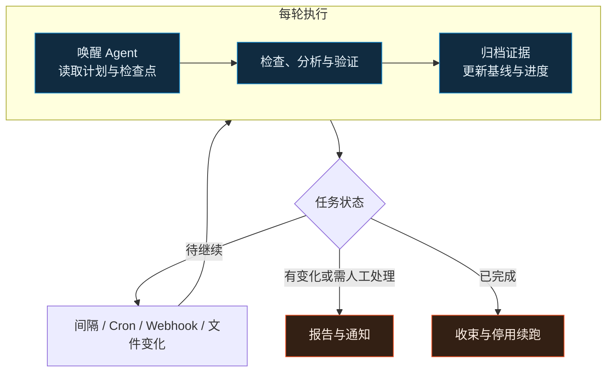

<p align="center">
  
</p>

<h1 align="center">ArgusAI</h1>

<p align="center">
  <strong>把目标交给 Agent，让它在 ArgusAI 中完成工作。</strong><br>
  本地工作台 · 长时自主执行 · 主动防护 · 持续攻防
</p>

<p align="center">
  
  
  
  <a href="LICENSE"></a>
</p>

<p align="center">
  <a href="wiki/Home.md"><strong>使用文档</strong></a> ·
  <a href="wiki/Quick-Start.md">快速开始</a> ·
  <a href="#运行界面">运行界面</a> ·
  <a href="#持续执行与主动发现">持续执行</a> ·
  <a href="https://github.com/HG-ha/Argusai/releases">下载发行包</a> ·
  <a href="README.en.md">English</a> ·
  <a href="https://dawahezhi.com/">官网</a>
</p>

## Agent 贯穿整个工作台

ArgusAI 是由[达瓦科技](https://dawahezhi.com/)开源的 Agent 原生安全工作台。它将 AI 助手、扫描任务、浏览器、代理流量、逆向样本与证据放进同一个本地工作区，面向内网安全防护、应用安全防护、攻击溯源与持续攻防，支持从目标与材料整理，一直推进到受控验证、报告和整改复测。

把目标、材料和授权范围交给 Agent，由它组织扫描、浏览器、代理、逆向、知识管理与定时任务，连续推进分析、验证和交付。Agent 是开展工作的默认入口；各功能页面用于观察进度、查看证据，并在需要时介入。GUI、CLI 与 Python 内核连接同一套工作能力。

侧栏的完整对话与可拖动悬浮球都是任务入口，进入的是同一个 Agent 工作区。Agent 能理解当前应用页面、正在查看的任务或逆向作业，以及相关工作状态；引用具体材料后，它可以接着你正在做的工作继续执行。功能页与对话之间共享任务、样本和证据。

项目面向企业安全团队、应用安全工程师、安全研究人员和明确授权的测试人员。底层 Agent 运行时也支持文件处理、日常信息整理和桌面协作，当前内置工具与工作流重点覆盖安全分析和逆向研究。

## 运行界面

<table>
<tr>
<td width="50%" align="center" valign="top">
  <strong>桌面 Agent</strong><br>
  <a href="website/assets/screens/agent-light.webp">
    <picture>
      <source media="(prefers-color-scheme: dark)" srcset="website/assets/screens/agent-dark.webp">
      
    </picture>
  </a>
</td>
<td width="50%" align="center" valign="top">
  <strong>命令行</strong><br>
  <a href="website/assets/screens/cli-dark.webp">
    <picture>
      <source media="(prefers-color-scheme: dark)" srcset="website/assets/screens/cli-dark.webp">
      
    </picture>
  </a>
</td>
</tr>
</table>

<details>
<summary><strong>沙盒预览</strong></summary>

<p align="center">
  <a href="website/assets/screens/sandbox-light.webp">
    <picture>
      <source media="(prefers-color-scheme: dark)" srcset="website/assets/screens/sandbox-dark.webp">
      
    </picture>
  </a>
</p>

</details>

## 一个工作区，连接分析与执行

<table>
<tr>
<td width="50%" valign="top">
<h3>Agent 对话、悬浮球与小队</h3>
<p>支持数十小时级单轮自主执行，持续组织工具调用、Skills、计划与待办，配合上下文压缩、证据归档和进展检查推进长任务。</p>
<p>持久小队可按角色、模型与工具范围分工协作。</p>
<p>通过对话菜单或悬浮球进入同一 Agent 工作区。浮球显示运行与未读状态，展开后可继续对话、查看工具步骤和处理确认；每个对话独立保存模型与自动审批状态。</p>
<a href="wiki/Agent-and-Sessions.md">Agent 入口、小队与会话设置 →</a>
</td>
<td width="50%" valign="top">
<h3>持续任务与主动发现</h3>
<p>固定间隔、Cron、签名 Webhook、文件变化四类触发；支持新建对话、任务专属对话或继续现有对话。</p>
<p>按检查点续跑，安排周期巡检，对比基线、发现变化并报告。</p>
<a href="wiki/Automation.md">调度、续跑与巡检 →</a>
</td>
</tr>
<tr>
<td width="50%" valign="top">
<h3>Web 审计与流量分析</h3>
<p>内置 Web 检查、浏览器实时观看与接管、原始请求与重放；HTTP/1.1、HTTP/2 MITM、WebSocket、断点及可选改写。</p>
<p>支持 HAR 与 Burp 日志导入，把已有材料接入分析流程。</p>
<a href="wiki/Web-Audit-and-Proxy.md">扫描、浏览器与代理 →</a>
</td>
<td width="50%" valign="top">
<h3>统一逆向工作台</h3>
<p>JS、WASM、APK、IPA、PE、ELF 和 HAR 进入 ReverseJob，关联静态初筛、解包、反编译、动态观察和证据。</p>
<p>按需连接 JADX、APKTool、Ghidra、Frida、capa、yara 等工具。</p>
<a href="wiki/Reverse-Workbench.md">样本与逆向任务 →</a>
</td>
</tr>
<tr>
<td width="50%" valign="top">
<h3>证据、记忆与知识</h3>
<p>Case、Artifact、Evidence 与发现相互关联；会话记忆、知识库和大结果归档支持复查与跨轮延续。</p>
<p>扫描报告可导出为 HTML、Markdown 和 JSON，便于整理交付。</p>
<a href="wiki/Enterprise-Workflows.md">企业工作流与交付 →</a>
</td>
<td width="50%" valign="top">
<h3>工具生态与开放扩展</h3>
<p>Python Check、Agent Tool、Markdown Skill、MCP、本地 ACP Agent、QQ/飞书/Telegram 等配对通信渠道，以及桌面自动化。QQ 支持官方扫码绑定，也保留 App ID / Client Secret 手动配置。</p>
<p>渠道回复支持平台适配的流式阶段消息和 <code>channel_reply</code> 多气泡回复；表达遵循全局用户习惯，软件内对话与悬浮球同样生效。</p>
<p>编排外部扫描器，接入云、IaC、SBOM、离线流量、固件等专项工作流。</p>
<a href="wiki/Integrations.md">扩展、渠道与工具依赖 →</a>
</td>
</tr>
</table>

从完整对话或悬浮球描述目标，例如“继续当前应用审计，完善计划，在授权范围内推进分析并保存证据”。Agent 围绕当前任务组织工具执行；你可以打开相关功能页查看进度与结果，需要补充材料时从沙盒把文件拖到浮球，将引用带入对话继续工作。

内置检查、技能工作流和外部工具集成分别承担不同环节。具体功能的输入、依赖与使用步骤见 [Wiki 使用手册](wiki/Home.md)。

## 持续执行与主动发现

### 数十小时级单轮自主执行

ArgusAI 支持数十小时级的单轮自主执行。这里的“单轮”指一次用户任务内连续进行的多次模型与工具调用，不是单次 HTTP 或模型请求。运行时没有固定的模型/工具轮次上限，默认单轮紧急时限为 7 天，并保留进展检查、死循环检测、取消与截止机制。

这是运行时配置与控制流提供的能力，实际时长受任务、模型额度、工具、资源和授权限制。长调查、样本批分析和多阶段验证可以在同一轮内持续推进；需要跨轮或在下一次事件发生时继续的工作，由持久任务与调度器接续。

### 跨轮续跑与事件驱动

Agent 将进度保存为待办、检查点、知识和产物，调度器在后续触发时接上工作。

<div align="center">



</div>

| 何时触发 | 适合做什么 |
| --- | --- |
| 固定间隔 `interval` | 周期巡检、查询扫描进度、复核新增流量 |
| 日历规则 `cron` | 每日资产复查、每周暴露面审查、定时简报 |
| 签名事件 `webhook` | 对接测试构建、外部告警或其他流程事件 |
| 文件变化 `file_change` | 分析新日志、新报告或样本目录中的变化 |

触发方式与执行对话可以独立组合：

| 在哪里执行 | 上下文如何延续 |
| --- | --- |
| 每次新建对话 `new_session` | 每次运行记录独立，通过任务上下文、知识与产物传递状态 |
| 任务专属对话 `dedicated_session` | 同一任务在自己的对话中积累跨次运行记录 |
| 继续现有对话 `session` | 接上指定对话中的历史、待办和检查点 |

长任务可使用 `max_runs=0`，不按固定执行次数结束，在多轮之间读取检查点、完成下一步、再次保存。这种持久分段续跑配合上下文压缩和证据归档，可以支持长期调查、持续巡检和多阶段任务。调度器、模型和工具需要保持可用；必要信息、资源与授权边界仍决定每一轮能否继续。

<details>
<summary><strong>任务示例：自动巡检与变化通知</strong></summary>

> 每天在约定窗口复核已授权的测试服务，按知识库中保存的检查步骤执行。对照上次记录整理新增资产和配置变化，保存证据。无变化时保持安静；有新增风险、执行失败或需要人工处理时通知我。不进行改写、修复或扩大目标范围。

> 继续当前对话中尚未完成的分析。先读待办和最近检查点，不重复已完成步骤；每轮保存进度。需要我补充信息时报告阻塞原因，全部完成后停止续跑并整理结论。

</details>

查看 [自动化手册](wiki/Automation.md)，选择触发器、对话目的地、运行次数与通知策略。

## 企业中的实际工作流程

| 工作方向 | 组织输入与执行过程 | 形成的工作材料 |
| --- | --- | --- |
| 内网安全防护 | 明确授权的 IP/CIDR、主机与 SSH 范围，发现资产并分析服务暴露；在已配置 SSH 的主机上只读检查监听端口、防火墙摘要、失败登录和关键服务版本，持续对比基线 | 资产覆盖表、暴露面变化、风险优先级、加固建议与原始证据引用 |
| 应用安全防护 | 对接预发布目标、测试身份、接口材料、HAR/JS 与业务日志，联动 Web 检查、浏览器和代理复核配置、认证、访问控制与异常请求，安排整改验证 | 接口与风险清单、可复现请求、请求/响应证据、修复建议与复测记录 |
| 攻击溯源 | 在选定时间窗口内整理业务日志、主机审计、代理流量及已提供的 WAF/EDR/SIEM 告警，关联时间、账号、IP、进程和请求标识，检查调查假设 | 事件时间线、证据关系、已观察事实与推断、置信度和证据缺口；归因以实际证据为准 |
| 持续攻防 | 围绕已授权资产与约定靶场，通过长时单轮执行、周期任务和事件触发，串联暴露面发现、单独授权的受控验证、检测证据复核与整改复测 | 演练链路、检测覆盖与差距、变化通知、复盘材料，以及可复用的技能和防护检查步骤 |

告警与远程状态通过使用者提供的材料或已配置工具获取，按授权范围组织检查与验证。漏洞定性、风险接受、生产变更与事件处置由负责团队审核。查看[企业工作流](wiki/Enterprise-Workflows.md)了解任务输入、人工复核点和交付组织。

## 快速开始

当前版本为 `0.1.4`。源码运行需要 Python 3.12+、uv、Node.js 18+ 和 npm；在项目根目录执行：

```sh
uv sync --locked
npm --prefix argusai/webui ci
npm --prefix argusai/webui run build
uv run argusai --gui
```

首次启动后，在设置页配置 AI 端点、模型和数据目录，按需要检查浏览器与外部工具路径。接着打开完整 Agent 对话或点击悬浮球，把目标、材料和约束交给 Agent，让它建立计划并开展工作。第一次可以提供一份允许分析的 HAR 或 JS，让 Agent 整理接口、标注疑点并归档证据，再到相应功能页核对结果。

| 选择入口 | 如何开始 | 继续阅读 |
| --- | --- | --- |
| 完整 Agent 对话 | 从侧栏进入或新建对话，直接描述目标并交给 Agent 执行 | [Agent 与会话](wiki/Agent-and-Sessions.md) |
| Agent 悬浮球 | 在功能页点击浮球接续当前工作；可拖动位置，查看运行和未读提示 | [浮球与工作台协作](wiki/Agent-and-Sessions.md) |
| 启动桌面 | `uv run argusai --gui` | [快速开始](wiki/Quick-Start.md) |
| 交互终端 | `uv run argusai` 或 `uv run argusai chat` | [CLI 命令参考](wiki/CLI-Reference.md) |
| 发行包 | 从 [Releases](https://github.com/HG-ha/Argusai/releases) 下载发布后对应平台的包与 `.sha256` | [安装与环境](wiki/Installation.md) |

Windows 桌面需要 WebView2 Runtime，Windows ARM64 还需要原生 Microsoft .NET Desktop Runtime；macOS 桌面自动化需要系统权限；Linux 桌面需要 GTK 与 WebKitGTK。外部模型、扫描器、逆向 CLI 和设备按功能准备，详细步骤见[安装说明](wiki/Installation.md)。

<details>
<summary><strong>构建、开发与发布</strong></summary>

三个平台统一使用 Python 构建入口，在目标系统和目标架构环境中运行：

```sh
uv run --locked --group build python build.py --help
uv run --locked --group build python build.py --dry-run
uv run --locked --group build python build.py --jobs 2
```

Windows 可加 `--nsis`，macOS 可加 `--dmg`，`--onefile` 生成单文件；Linux 同时生成发布压缩包。完整的构建依赖、签名、校验和与 GitHub Actions 发布流程见[构建与发布](wiki/Build-and-Release.md)。

开发规范见 [AGENTS.md](AGENTS.md)，架构与扩展入口见[架构与开发](wiki/Architecture-and-Development.md)。测试使用 `uv run pytest`，前端开发使用 `npm --prefix argusai/webui run dev`。

</details>

## 文档导航

<table>
<tr>
<td width="33%" valign="top">
<h3>开始使用</h3>
<p><a href="wiki/Quick-Start.md">快速开始</a><br><a href="wiki/Installation.md">安装与环境</a><br><a href="wiki/Agent-and-Sessions.md">Agent、对话与小队</a><br><a href="wiki/CLI-Reference.md">CLI 命令参考</a></p>
</td>
<td width="33%" valign="top">
<h3>开展工作</h3>
<p><a href="wiki/Automation.md">定时、续跑与自动巡检</a><br><a href="wiki/Web-Audit-and-Proxy.md">Web 审计与代理</a><br><a href="wiki/Reverse-Workbench.md">逆向工作台</a><br><a href="wiki/Enterprise-Workflows.md">企业工作流</a></p>
</td>
<td width="33%" valign="top">
<h3>配置与扩展</h3>
<p><a href="wiki/Integrations.md">模型、工具与集成</a><br><a href="wiki/Data-and-Safety.md">数据与使用边界</a><br><a href="wiki/Troubleshooting.md">故障排查</a><br><a href="wiki/Build-and-Release.md">构建与发布</a></p>
</td>
</tr>
</table>

## 数据与使用边界

会话、任务、知识库、逆向产物和日志保存在配置的数据目录中。AI 请求发送到用户配置的服务，搜索、下载、通信渠道和带外验证等功能也可能访问外部服务。会话级文件与运行时隔离用于组织执行，实际访问能力仍受工具授权和宿主机权限约束。

ArgusAI 用于自有系统、明确授权的安全评估和隔离实验环境。请对目标、方法、时间与影响范围取得授权，复核模型结论，并为主动扫描、流量改写、动态注入和生产定时任务评估影响。完整说明见[数据与使用边界](wiki/Data-and-Safety.md)。

## 许可证

除另有说明的第三方内容外，ArgusAI 采用 [GNU GPL 第 3 版](LICENSE)（`GPL-3.0-only`），不自动授予后续版本许可。个人与企业均可按该许可证使用、修改和商用，无需因企业身份另购软件使用授权。

分发程序或受 GPL 约束的整合作品时，须按 GPLv3 提供对应源代码，保留版权与许可声明，并履行其他适用条件。完整条款以 [LICENSE](LICENSE) 为准。

随附第三方组件保留各自许可证，具体范围与声明见 [THIRD_PARTY_NOTICES.md](THIRD_PARTY_NOTICES.md)。达瓦科技可提供部署、集成、定制与技术支持等商业服务；商业服务不改变 GPL 已授予的权利。

## 参与项目

欢迎提交可复现的问题、工具适配、检测规则、Skills 和界面改进。请提供版本、操作系统、复现步骤与脱敏日志，保留第三方工具和 vendor 代码的许可声明。

贡献按对应文件适用的许可证提交，项目代码适用 `GPL-3.0-only`，第三方内容遵循其原有许可证。贡献者保留自己的版权。

[提交问题](https://github.com/HG-ha/Argusai/issues) · [开发规约](AGENTS.md) · [架构与开发](wiki/Architecture-and-Development.md) · [Wiki 维护](wiki/Wiki-Maintenance.md)

<p align="center">由 <a href="https://dawahezhi.com/">达瓦科技</a> 开源 · <a href="https://github.com/HG-ha/Argusai">HG-ha/Argusai</a></p>
