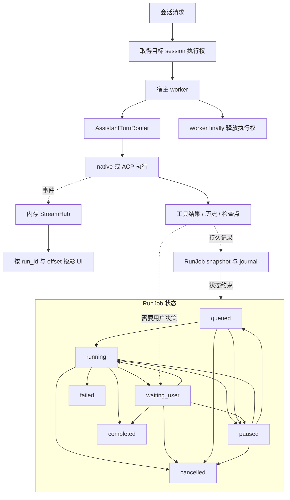
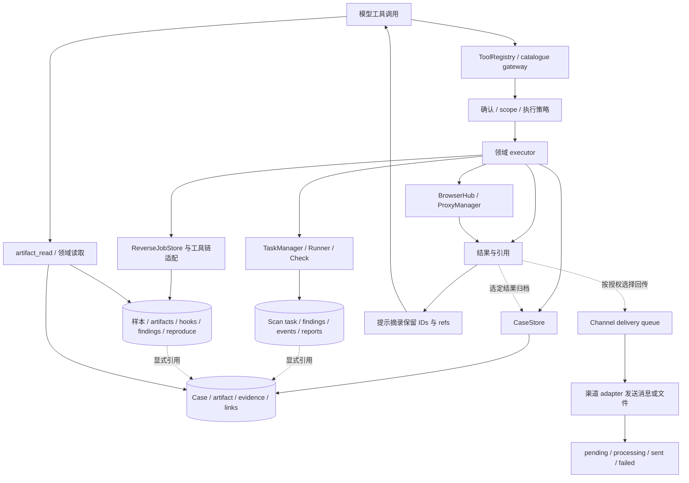

# 架构与开发

[文档首页](Home.md) · [工程规约](../AGENTS.md) · [构建与发布](Build-and-Release.md)

本页按一次 Agent 工作的执行路径解释源码：请求如何取得会话执行权，工具如何获准运行，结果如何进入领域存储，以及后台工作怎样再次唤醒会话。公开使用说明放在 `wiki/`，运行时技能放在 `argusai/skills/`；被忽略的 `docs/` 用于本地工程补充，不能作为公开使用指南的唯一来源。

## 开发导航

| 位置 | 负责什么 |
| --- | --- |
| `argusai/cli/` | Typer 命令、交互控制台和无界面托管入口 |
| `argusai/gui/` | pywebview 桥接，按任务、会话、代理、逆向等功能拆分 mixin |
| `argusai/core/assistant/` | 会话循环、工具、确认、上下文预算、记忆、小队和调度 |
| `argusai/core/agent_runtimes/` | 外部运行时绑定、ACP 连接与工具 broker |
| `argusai/core/tools/` | 按领域实现的工具 executor 聚合 |
| `argusai/core/browser/` | 浏览器发现、启动、会话和实况控制 |
| `argusai/core/security/` | 被动代理、流量互操作与扫描器桥接 |
| `argusai/core/reverse/` | ReverseJob、工具链、样本与产物 |
| `argusai/core/workspace/` | Case、知识库、沙盒和工作区导出 |
| `argusai/checks/` | 注册到扫描内核的 Check |
| `argusai/webui/src/` | Vue 面板、状态、API wrapper 与多语言文案 |
| `argusai/report/` | 报告渲染和模板 |
| `tests/` | pytest 回归测试 |

[AssistantSession](../argusai/core/assistant/session.py) 通过 mixin 组合聊天循环、工具执行、预算和记忆。运行监督由会话、宿主执行锁、RunJob 存储和循环控制共同完成。修改运行时之前，应先确定行为归属，避免把 GUI 的执行锁搬进领域工具，或把 UI 的临时状态当作任务事实。

## Agent 运行时与数据流

### 会话、任务与流的三个身份

一次聊天涉及三种不同寿命的标识。区分它们，才能解释恢复、取消和重新连接的行为。

| 标识 | 寿命与用途 |
| --- | --- |
| `session_id` | 一个持久会话，关联历史、配置、确认状态和会话工作目录 |
| `job_id` | 一次可跟踪的 Agent 运行，关联状态、预算、检查点和事件日志 |
| `run_id` | 本次宿主执行的内存事件流，供前端按 offset 拉取 |

恢复既有 RunJob 时保留 `job_id`，同时创建新的 `run_id`。旧窗口拿着旧流的 offset，不会误读恢复后那一轮的事件。会话的模型选择与自动审批按会话保存，全局默认值用于初始化新会话。

[assistant_stream.py](../argusai/gui/assistant_stream.py) 的 `_start_assistant_stream()` 在启动 worker 前取得会话执行权。`_assistant_run_lock` 保护宿主中的运行集合，同一会话不能同时进入两个聊天循环。取消请求也不等于 worker 已退出：运行所有权由 worker 的 `finally` 释放，存活 worker 不会仅因界面超时或流被标记结束就被回收。

下面以桌面宿主中的执行为例，把运行所有权与持久状态放在一张图中。虚线表示记录或投影；状态间的返回路径仍需显式继续、确认或恢复请求。



[run_jobs.py](../argusai/core/assistant/run_jobs.py) 中 `AssistantRunState` 与 `_ALLOWED_TRANSITIONS` 限制合法状态变化。`waiting_user` 表示当前需要人处理，`paused` 可恢复；`completed` 表示这一轮运行结束，不能据此推断长期巡检目标已经完成。终态没有普通的继续边，新一轮工作需要另建运行。

`AssistantRunJobStore.transition()` 在转换状态前写入待提交检查点；`checkpoint_throttled()` 合并高频进度更新。JSON 快照使用替换写入，JSONL 事件有递增序号并执行 flush/fsync；日志到达阈值后会压缩为近期尾部。它提供恢复所需的运行记录，不承诺永久保留每个历史事件。

进程退出后，未受活跃宿主保护的 `running` 记录在加载时恢复为 `paused`，由用户决定继续。运行记录和会话历史是持久层，token 流是内存层。普通聊天的辅助运行记录失败与显式恢复既有任务失败也有不同处理路径，不能把所有元数据失败都升级为对话不可用。

入口分流见 [turn_router.py](../argusai/core/assistant/turn_router.py) 的 `AssistantTurnRouter`。它路由原生运行时或已绑定外部运行时；绑定不可用时返回错误，不静默改用另一套模型或执行环境。它本身不提供跨宿主的通用持久消息队列。

## 稳定工具目录与执行策略

[tools/__init__.py](../argusai/core/tools/__init__.py) 聚合各领域 executor；[assistant/tools.py](../argusai/core/assistant/tools.py) 的 `build_tool_registry()` 将 executor、schema 和行为元数据组成 `ToolRegistry`。工具除了参数，还声明风险、`kind`、去重策略、并发方式和完成方式。

模型请求中的 `tools[]` 使用会话初始化后冻结的核心集合。[session_chat_loop.py](../argusai/core/assistant/session_chat_loop.py) 的 `_merge_prompt_tool_names()` 与 `_frozen_system_catalog()` 保持核心 schema 和系统工具目录稳定。领域工具通过 `tool_search` 查找 schema，再由 `invoke_catalogue_tool` 调用，发现工具不会反复扩写核心数组。

这个取舍减少重复传输和前缀缓存变化，也要求模型先读目录中的参数说明。目录调用最终仍进入正常执行与确认路径，不能绕过权限。渠道对话额外附带 `channel_reply`，该工具按当前交互面加入，不会永久污染桌面聊天的核心集合。

界面状态、检索记忆等易变内容经 `_attach_volatile_context()` 放到最近用户消息的尾部，减少系统前缀变化。这里保持的是请求组织的稳定性，最终缓存命中仍受提供者策略和请求内容影响。

[skills.py](../argusai/core/assistant/skills.py) 提供技能匹配与渐进加载：先给名称和说明，需要操作步骤时再用 `skill_read` 读取正文。Skill 描述工作方法，工具 schema 描述可执行接口。两者都不应通过不断往历史中塞重复说明来维持；长会话仍要遵守稳定的系统规则。

确认由会话工具策略与 [ConfirmationBroker](../argusai/core/assistant/confirmation_broker.py) 配合处理。`prepare()` 规范化决策，并关联 `pending_id`、版本和调用标识；外部工具通过 `open_external()` 建立等待票据，再由确认动作解析。远程渠道不能用一次远程消息扩展会话级自动审批，要求本地确认的权限仍回到本地界面。

高风险工具的分类与额外授权要求见 [streaming.py](../argusai/core/assistant/streaming.py) 和 [tool_policy.py](../argusai/core/assistant/tool_policy.py)。新增 executor 时必须同时检查风险分类、scope 校验和确认集合，不能只把工具加入注册表。

### 只读并行与资源键

[session_loop_control.py](../argusai/core/assistant/session_loop_control.py) 的 `_execute_tool_calls_batch()` 按模型给出的调用顺序构建连续的并行波次。工具必须允许 `read_parallel`，不能是 mutating、presentation、control 或后台完成类型；需要确认却尚未获准的工具也不能进入该波次。

每个波次还要求 `Tool.resource_keys(arguments)` 互不相交。默认资源键是工具名，自定义 resolver 可进一步描述共享资源；遇到冲突或串行工具就结束当前波次。并发完成后，工具结果、trace 和历史仍按原始调用顺序提交，避免网络返回先后改变模型看到的因果顺序。

因此，`read_parallel` 是带条件的调度许可，资源键也是本批执行器的冲突判断。它们不能代替跨会话的数据库锁，未声明资源关系的工具也不会自动获得全局互斥。工具维护者需要准确声明元数据，并在领域存储中保留自己的并发保护。

## 长任务循环与上下文预算

[session_loop_control.py](../argusai/core/assistant/session_loop_control.py) 的 `_agent_round_iter()` 不用固定轮次数作为主停止条件。每轮检查取消、墙钟截止时间、用户决策和执行进展；相同调用反复出现、轮询无变化、失败循环等模式进入提示或停止路径。没有固定轮数上限不代表没有运行预算。

自动续跑只会使用本轮实际触及的未完成 Todo 等信号，旧会话留下的待办不能劫持用户的新问题。验收循环可以检查验证 Todo 和证据引用，并进行有界修复；[acceptance.py](../argusai/core/assistant/acceptance.py) 的 `verify_validation_plan()` 检查状态及证据字段存在性，不会自动证明漏洞结论为真。

[session_budget.py](../argusai/core/assistant/session_budget.py) 在发送前按请求体积估计和模型窗口配置触发上下文压缩；输入框的占用显示另结合提供者最近的 token 使用量进行校准。`_compact_old_tool_results_in_place()` 在实际体积压力下压缩较早结果，保留近期窗口、调用身份和产物引用。旧历史还可经过摘要或记忆检索恢复，不能把压缩理解为完整原文始终留在模型窗口中。

取消、异常或提前停止可能留下已经发出的 tool call。`_fill_missing_tool_results()` 补齐对应结果，维持调用与结果配对，避免下一次请求提交悬空调用；它不会重新执行工具副作用。修改历史工具的名称或 schema 会影响重放，不能依赖这个修复器来弥补接口破坏。

[session_memory.py](../argusai/core/assistant/session_memory.py) 将提示中的结果与磁盘上的原始结果分开：

| 环节 | 行为 |
| --- | --- |
| `_auto_archive_tool_result()` | 对选定的高价值工具结果写 Case artifact，并返回 `case_id`、`artifact_ref` 等引用 |
| `_tool_result_to_prompt()` | 对长字段做摘录、限制总量，展示卡片只返回模型需要的简短确认 |
| `artifact_read` 等读取工具 | 需要细节时，按引用重新读取已保存内容 |

归档只覆盖选定工具和合适的结果形态，归档异常按尽力保存处理。工具自己已有的领域产物也应保留引用。开发者不能假设任意工具输出都会自动保存，更不能用一段压缩摘要代替漏洞证据原文。

## 原生运行时与 ACP

原生运行时由 `AssistantSession.chat()` 组织提供者请求、工具循环和历史。ACP 路径通过 [acp_runtime.py](../argusai/core/agent_runtimes/acp_runtime.py) 的 `ACPAgentProcess` 管理子进程与 stdio 连接，再由 [acp_turn.py](../argusai/core/agent_runtimes/acp_turn.py) 的 `run_acp_turn()` 执行会话生命周期。

ACP 的过程是启动进程、`initialize` 协商、按能力 `load_session` 或 `new_session`，应用可用配置，再发送 prompt 并收集更新。只有对端声明支持 `loadSession` 且已有会话标识时才尝试加载。图片、音频等附件也按对端能力协商，不能仅凭本地 UI 能选附件就断言外部 Agent 一定能读取。

会话指定的项目目录优先于运行时默认 cwd。ArgusAI 在握手中不提供客户端文件读写与 terminal 能力；外部 Agent 可使用自身拥有的文件、命令行能力。ACP 客户端按收到的 NDJSON 顺序观察 `session/update`，避免最终 prompt 返回后才补到的文本打乱显示。

外部 Agent 调用 ArgusAI 能力时，经 [tool_broker.py](../argusai/core/agent_runtimes/tool_broker.py) 的 `ArgusAIToolBroker` 桥接：

1. broker 监听动态端口的 `127.0.0.1`，每个会话绑定生成独立随机 token。
2. 内部 MCP proxy 向 ACP 暴露少量核心工具和 `argusai_invoke_tool` 目录网关。
3. broker 校验 token、绑定与工具可见性，按会话执行锁串行处理共享状态。
4. 请求通过确认票据进入正常 `_dispatch_tool()`，再记录 trace、检查点和适用的产物引用。

注销绑定或关闭 broker 时会取消相应外部确认票据。最小接口减少外部运行时一次加载的工具数量，但这个 broker 只管理经过它的 ArgusAI 调用，无法管住外部 Agent 自身的所有 shell 行为。

作为客户端连接第三方 MCP 服务的路径位于 [infra/mcp_client.py](../argusai/core/infra/mcp_client.py)，与上述供 ACP 回调的 broker 是两个方向。会话沙盒位于 [session_sandbox.py](../argusai/core/workspace/session_sandbox.py)，提供受管理的工作目录和脚本环境；浏览器、MITM、外部 Agent 与所有领域工具没有统一包在一个操作系统隔离容器中。

## 子 Agent、小队消息与执行收件箱

[agent_threads.py](../argusai/core/assistant/agent_threads.py) 的 `_child_registry()` 为子 Agent 建立能力投影：`readonly` 取安全只读集合，`scoped` 取明确委派的工具，移除继续委派的控制工具。子会话构建后再次移除这些控制项，嵌套限制有执行层约束。

能力投影决定工具是否存在，角色提示不承担授权职责。持久小队成员按 `leader_auto` 或 `manual` 策略处理确认；前者给投影内工具设置委派授权，后者保留人工确认。领域工具内的 engagement 和 scope 检查仍需执行。同步 `run_subagent` 的 scoped 模式目前保留未启用，不能与持久成员的委派接口混为一谈。

小队有两份不同用途的数据，[gui/teams.py](../argusai/gui/teams.py) 和 `AgentThreadManager` 通过消息引用连接它们：

| 数据 | 解决的问题 |
| --- | --- |
| Team Room 消息日志 | 保存公共或私聊消息、顺序、来源及每个成员的读取游标 |
| 成员 `pending_inputs` | 保存尚未执行的输入、可见性、去重引用及等待状态 |

`_route_team_room_message()` 对公共消息投递给其他成员，明确的 `@角色` 保持独立待处理项。`send_input(interrupt=False, input_ref=...)` 在成员忙时只排队，不调用插话暂停；普通公共消息可把相邻、未执行的同类输入合并，显式请求和确认项形成顺序边界。文本预算用完后建立下一项，不截掉后续消息。

接受入队不会推进 Room 的读取游标。成员真正准备本轮上下文时，`_team_room_context()` 根据当前输入引用设置读取上界并排除已直接投递的正文，防止把未来请求提前读入或重复执行。同一消息的 pending、active 和近期处理引用用于去重，不能把有界去重历史描述为永久全局 exactly-once。

手动暂停、关闭和待确认都优先于自动收件。并发名额不足时持久记录 `waiting_for_slot`，在名额释放时续接；进程重启恢复出的暂停不会被这个路径偷偷唤醒。私聊的待确认状态携带本轮可见性，确认后仍按私聊继续。

普通群消息由成员按职责决定是否参与，无需回复时使用 `team_room_pass` 静默结束。临时子 Agent 的完成通知可唤醒其父会话；持久 `team-*` 容器不走这个主会话唤醒路径，也不会自动唤醒任意其他聊天。

## 持久调度与下一次唤醒

[cron.py](../argusai/core/assistant/cron.py) 的 `CronScheduler.start()` 获取数据目录内的进程文件租约，避免两个宿主重复接管同一调度存储。`tick_once()` 再用 `_fire_lock` 串行触发调度运行。交互会话仍可独立工作；固定会话忙时检查的是目标会话，而非把所有交互都视为冲突。

触发器与会话目的地正交。一个 webhook 同样可以唤醒固定会话，也可以每次创建新会话。

| 触发器 | 触发依据 |
| --- | --- |
| `interval` | 距离上次计算的间隔时间 |
| `cron` | 五字段 cron 表达式，按宿主本地时区计算 |
| `webhook` | 经签名、时间窗口与事件去重检查的外部事件 |
| `file_change` | 目录文件的 mtime/大小快照变化 |

| `destination` | 上下文关系 |
| --- | --- |
| `new_session` | 每次新建调度会话，不克隆创建者的聊天历史 |
| `dedicated_session` | 复用该任务专属的会话 |
| `session` | 唤醒指定的既有会话，沿用其历史 |

[cron_triggers.py](../argusai/core/assistant/cron_triggers.py) 管理 webhook 和文件事件。文件监听首次保存基线，不把已有文件都当作新增；mtime/大小快照也不等价于逐字节完整性检查。任务、运行记录、基线与事件队列通过 `CronStore` 写入磁盘，事件队列、去重集合与运行历史都有容量边界。

目标会话繁忙时，调度保存 `pending_fire` 并延后。超过配置的等待期限会记为 `skipped_busy`，默认期限为一小时；因此不能承诺所有触发都无限积压并最终执行。正数 `max_runs` 达到次数后停用，`0` 表示不按次数停止。长期目标完成后，Agent 还需按约定停用任务，单轮 `completed` 不会自动替它判断目标已经结束。

[assistant_cron.py](../argusai/gui/assistant_cron.py) 的 `_fire_assistant_cron_job()` 将唤醒作为带任务来源的系统事件投影到会话，同时通过正常执行锁运行。业务检查点、文件、Todo 或知识笔记仍应由 Agent 明确保存，调度器不会自动替它理解并保存全部业务进度。

`report_to_origin` 可把结果回送创建会话；空闲时可启动结果处理轮，繁忙时保存事件或消息并标记延后，不能承诺每种延后结果都会再触发一次执行。`on_change_only` 依赖约定的无变化摘要，不是通用语义差分器。调度宿主必须保持运行，设备关闭后不会继续执行本地任务。

## 工具结果进入三条领域持久化链路

工具最终调用具体领域服务，而非把所有状态都塞进聊天历史。下面实线表示执行或读取路径，虚线表示选择性归档或显式关联；三条存储没有一个覆盖全局的数据库事务。



### Scan：检查任务与报告

[gui/tasks.py](../argusai/gui/tasks.py) 的 `create_task()` 进入 `TaskManager`，由 [tasks.py](../argusai/core/tasks.py) 管理任务目录、状态和事件。任务线程建立 asyncio 执行环境，`_do_run()` 调用 [Runner](../argusai/core/runner.py)，按注册顺序运行 Check；`_render_reports()` 生成 HTML、Markdown 和 JSON 报告。

Check 是异步生成器，产出标准化 Finding。HTTP 限速、scope、共享信息与浏览器上下文使用 [Context](../argusai/core/context.py)；新增 Check 前查看 [check.py](../argusai/core/check.py)，使用 `@register`，并在 [checks/__init__.py](../argusai/checks/__init__.py) 导入。

[BrowserHub](../argusai/core/browser/browser_pool.py) 管理长生命周期的 Playwright 专用线程与事件循环，跨循环调用通过线程安全调度桥接；扫描 `Context.browser_context()` 则有独立 profile/context 管理。显式连接已有浏览器与独立扫描 context 的权限和 cookie 边界不同，不能一概视为共享浏览器。

[proxy.py](../argusai/core/security/proxy.py) 的 MITM 服务是独立 `ProxyManager` / `PassiveAnalyzer` 链路，复用 Finding、事件模型等契约。它不属于某个 Check，也不能据此推断所有浏览器和扫描流量都会自动经过 MITM。

代理在进程内独立线程和事件循环中运行。[TrafficFlow](../argusai/core/security/proxy_flow.py) 区分原始正文、解码视图、截断与回收状态，分析或导出应读取相应完整性字段，不能把界面显示的正文一概视为未截断原始字节。

### ReverseJob：样本及分析派生关系

[ReverseJobStore](../argusai/core/reverse/reverse_jobs.py) 保存 job 元数据和 artifacts、hooks、findings、reproduce 等目录。[reverse_job_artifacts.py](../argusai/core/reverse/reverse_job_artifacts.py) 的 `add_artifact()` 记录内容哈希、大小和来源，可通过 `from_artifact` 保留派生关系，后续读取不依赖模型记住整段反编译结果。

[reverse_artifacts.py](../argusai/core/reverse/reverse_artifacts.py) 使用 `rev://` 引用表达逆向产物身份；它与 Case 的 artifact ID 属于不同引用体系，跨链路读取应使用对应解析器。

逆向工具调用通过领域适配器组织。JADX、Ghidra、Frida 等外部工具是否可用取决于工具链环境，源码存在适配入口不代表每个平台安装包都内置完整工具链。

### Case：证据与跨资源关联

[CaseStore](../argusai/core/workspace/cases.py) 的 `add_artifact()` 保存原始内容及 SHA-256、大小、元数据；`add_evidence()` 将 artifact、interaction 与 finding 引用组织成证据说明，`add_link()` 保存跨资源边。Case 可关联 Scan 和 ReverseJob，但需要显式引用，三者不是同一份任务记录的三个名字。

文件快照替换写入、原始内容写入和事件追加具有各自边界，不能把它们描述为强事务或有签名的不可篡改取证链。哈希能帮助识别内容，漏洞成立与证据充分性仍需验证。

[KnowledgeBase](../argusai/core/workspace/knowledge.py) 使用 Markdown、YAML frontmatter 和索引保存知识与版本信息；默认实现不依赖向量数据库。[workspace_export.py](../argusai/core/workspace/workspace_export.py) 负责报告和工作区打包，导出前应检查引用是否指向实际保存的文件。

### 渠道交付：运行完成与投递完成分开

[channel_tools.py](../argusai/core/tools/channel_tools.py) 的 `channel_send_message()` 与 `channel_send_file()` 将结果摘要和文件加入出站队列，返回 `delivery_id`。文件发送从当前会话沙盒解析路径，记录大小和 SHA-256；领域报告需要先准备为可发送文件，再按用户授权选择目标。

[channels/runtime.py](../argusai/core/channels/runtime.py) 调度 adapter 投递，[channels/store.py](../argusai/core/channels/store.py) 保存状态和重试信息。`ok`、`queued` 或回复已 accepted 只说明提交被接受，最终状态需用 `channel_delivery_status()` 查看；失败保留平台原因，不能把 Agent 本轮结束等同于收件人已经收到消息。`sent` 也不代表用户已读。

## UI 协议与前后端契约

[ui_protocol.py](../argusai/core/assistant/ui_protocol.py) 定义 AI UI Protocol v2 的规范化入口；[assistantProtocol.js](../argusai/webui/src/assistantProtocol.js) 对应前端处理。消息、附件、选区引用、动作与 block 都有各自的规范化函数；旧 block 可补齐 `id`、`version`、`source`，确认卡片也能派生 typed payload，同时保留旧字段供现有组件读取。

提供者的正文增量经 `on_delta` 形成 `text_chunk`，工具 trace 和确认等卡片使用 `block_upsert`，依靠 block 身份更新。不同事件共用流传输，但保持各自的展示语义。新增交互应先核对协议动作，再连接已有 bridge 方法；展示层合并或去重不能代替后端执行去重。

[StreamHub](../argusai/core/assistant/stream_hub.py) 为每个流保存带锁的事件列表，`publish()` 规范化事件，`read(offset)` 返回增量与下一 offset，`finish()` 标记流结束。这些缓冲区只在当前进程中；重新启动后加载的是已保存历史与任务状态，不能恢复到每一个尚未落盘的 token。

[api.js](../argusai/webui/src/api.js) 中 `call("method")` 必须有对应 Python `Api` 方法。修改 bridge 时同时核对所属 mixin、JS wrapper 和全部调用方，优先保留已有公开方法名。

工程不可变契约以 [AGENTS.md](../AGENTS.md) 为准，包括包公开导出、`settings_mgr`、GUI 入口、持久数据目录名、Check ID、Finding 指纹以及 AI 工具名称和 schema。历史会话保存的 tool use 也会重放，接口兼容需要与新请求同等对待。

## 日常开发

```sh
uv sync --locked
npm --prefix argusai/webui ci
npm --prefix argusai/webui run dev
```

Vite 用于前端开发；桌面打包运行需要构建后的 `webui/dist`。前端变更完成后执行：

```sh
npm --prefix argusai/webui run build
```

后端测试按受影响模块选择：

```sh
uv run pytest tests/gui/test_api_contract.py -q
uv run pytest tests/scripts/ -q
```

新增测试放在对应模块目录，用 fixture、mock 或本地服务替代外部网络。运行锁、取消和收件箱修改需要覆盖真实异步时序，不能只断言源码里出现某个字段。不要把真实密钥、用户会话或审计样本作为 fixture。

## 版本与文档维护

版本源为 `argusai/__init__.py`，通过 `scripts/bump_version.py` 同步前端包元数据。发布前校验版本与标签，具体见 [构建与发布](Build-and-Release.md)。

修改命令、配置或 GUI 行为时，同步对应 Wiki 页面。`scripts/wiki_docs.py check` 检查文档链接和基本结构；导出到独立 GitHub Wiki 的步骤见 [Wiki 维护](Wiki-Maintenance.md)。

第三方 vendor 代码按工程规约处理，保留许可和来源。构建文件只分发需要的工具资源，不把用户运行时目录、密钥或完整开发工具链打进产物。
