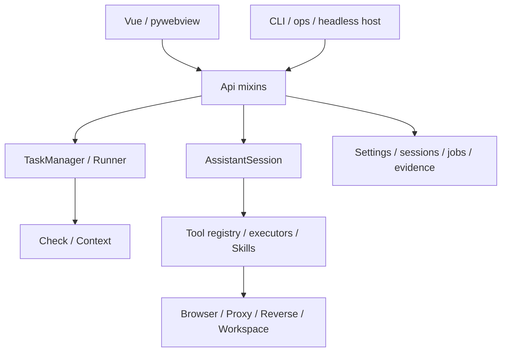

# 架构与开发

[文档首页](Home.md) · [工程规约](../AGENTS.md) · [构建与发布](Build-and-Release.md)

本页帮助开发者找到修改入口。公开使用说明放在 `wiki/`，运行时读取的技能放在 `argusai/skills/`；被忽略的 `docs/` 用于本地工程补充，不能作为公开安装和使用指南的唯一来源。

## 模块关系



| 位置 | 负责什么 |
| --- | --- |
| `argusai/cli/` | Typer 命令、交互控制台和无界面托管入口 |
| `argusai/gui/` | pywebview 桥接，按任务、会话、代理、逆向等功能拆分 mixin |
| `argusai/core/assistant/` | 会话循环、工具、确认、上下文预算、记忆、小队、后台任务与调度 |
| `argusai/core/tools/` | 按领域实现的工具 executor 聚合 |
| `argusai/core/browser/` | 浏览器发现、启动、会话和实况相关能力 |
| `argusai/core/security/` | 被动代理、流量互操作与扫描器等桥接 |
| `argusai/core/reverse/` | ReverseJob、工具链、样本与产物 |
| `argusai/core/workspace/` | 工作区、沙盒与领域相关支持 |
| `argusai/checks/` | 注册到扫描内核的 Check |
| `argusai/webui/src/` | Vue 面板、状态、API wrapper 与多语言文案 |
| `argusai/report/` | 报告渲染和模板 |
| `tests/` | pytest 回归测试 |

## 扫描链路

`TaskManager` 为任务维护状态、事件和落盘目录，运行任务使用独立线程与 asyncio 循环。`Runner` 解析 Check 注册表，按顺序执行检查，并通过共享 `Context` 传递信息收集等中间结果。

Check 是异步生成器，产出标准化 Finding。HTTP、并发、浏览器和共享上下文应使用现有抽象，避免另起不受约束的网络执行路径。

新增 Check 前先查看 [check.py](../argusai/core/check.py) 和已有实现，使用 `@register`，并在 [checks/__init__.py](../argusai/checks/__init__.py) 导入。既有 Check ID 会进入持久任务，不能随意改名。

## Agent 链路

[AssistantSession](../argusai/core/assistant/session.py) 组合聊天循环、工具执行、预算、记忆和 UI blocks 等模块。工具目录与 schema 渐进加载；工具名称与参数需要保持历史会话可重放。

GUI 和其他宿主通过适配层调用运行时。模型提供者、会话选择和工具执行有不同职责，修改一层时需要确认另一层是否仍按契约工作。对话的自动审批和模型选择按会话保存，全局默认值只负责初始化新对话。

新增工具应放入已有合适领域，说明风险级别、scope 和确认要求。运行时 Skill 是产品能力的一部分，不应当作可随意删除的开发说明。

## 前后端契约

[api.js](../argusai/webui/src/api.js) 中 `call("method")` 的名字必须有对应 Python `Api` 方法。公开导出、GUI 入口、`settings_mgr`、数据目录名、Finding 指纹和工具 schema 的稳定性要求见 [AGENTS.md](../AGENTS.md)。

修改 bridge 方法时，要同时核对 Python、JS 和所有调用处。优先修改所属 mixin，避免把所有功能重新堆回一个文件。

## 日常开发

```sh
uv sync --locked
npm --prefix argusai/webui ci
npm --prefix argusai/webui run dev
```

Vite 用于前端开发；桌面打包运行需要构建后的 `webui/dist`。前端变更完成后执行：

```sh
npm --prefix argusai/webui run build
```

后端测试按受影响模块选择：

```sh
uv run pytest tests/gui/test_api_contract.py -q
uv run pytest tests/scripts/ -q
```

新增测试放在对应模块目录，用 fixture、mock 或本地服务替代外部网络。不要把真实密钥、用户会话或审计样本作为 fixture。

## 版本与文档维护

版本源为 `argusai/__init__.py`，通过 `scripts/bump_version.py` 同步前端包元数据。发布前校验版本与标签，具体见 [构建与发布](Build-and-Release.md)。

修改命令、配置或 GUI 行为时，同步对应 Wiki 页面。`scripts/wiki_docs.py check` 检查文档链接和基本结构；导出到独立 GitHub Wiki 的步骤见 [Wiki 维护](Wiki-Maintenance.md)。

第三方 vendor 代码按工程规约处理，保留许可和来源。构建文件只分发需要的工具资源，不把用户运行时目录、密钥或完整开发工具链打进产物。
