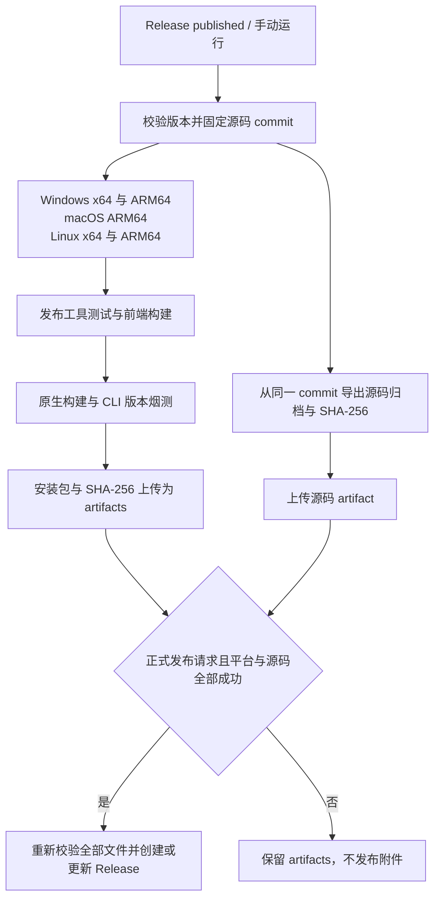

# 构建与发布

[Wiki 首页](Home.md) · [安装](Installation.md) · [架构与开发](Architecture-and-Development.md)

根目录 [build.py](../build.py) 统一编排 Windows、macOS 和 Linux 的原生构建。它会准备前端、调用 Nuitka，并按平台生成 NSIS、DMG 或 Linux 压缩包。构建仍需在目标 OS 与目标架构的环境中进行。

## 构建前提

| 共用依赖 | 说明 |
| --- | --- |
| Python 3.12+ 与 uv | 发布 CI 使用 Python 3.12；构建依赖在 `build` 组 |
| Node.js 与 npm | 默认通过 `npm ci` 安装前端依赖并构建；CI 使用 Node.js 22 |
| C 编译工具链 | 用于 Nuitka 原生编译 |
| 足够的磁盘与内存 | 包括 npm 依赖、编译中间文件、独立目录与安装包 |

| 平台 | 附加要求 |
| --- | --- |
| Windows | 适用的 C 工具链；生成安装器还需要 NSIS 3 |
| macOS | Xcode Command Line Tools；DMG 使用 hdiutil/Finder 等平台工具 |
| Linux | build-essential 或对应编译工具、pkg-config、patchelf，以及桌面运行库 |

脚本不会替你安装系统包或终止占用旧产物的应用。重建前关闭对应程序，系统依赖按平台准备。Linux 桌面构建还应先在构建解释器中验证所选 pywebview 图形后端，见[安装指南](Installation.md)中的 GTK/PyGObject 自检。

本版的原生发布目标如下。矩阵中的条目表示对应的构建目标；是否已有可下载包，以同一轮 CI 全部成功后的 Release 附件为准。

| 构建目标 | 原生 runner | 发行格式 | 依赖边界 |
| --- | --- | --- | --- |
| Windows x64 | `windows-2022` | `win-x64-setup.exe` | x64 Python、MSVC、NSIS 与 WebView2 |
| Windows ARM64 | `windows-11-arm` | `win-arm64-setup.exe` | ARM64 Python/MSVC；锁定 cryptography 需源码构建；.NET/WinForms/WebView2 需验证原生 ARM 路径 |
| macOS ARM64 | `macos-14` | `macos-arm64.dmg` | Apple Silicon Python、Xcode 工具与系统 WebKit |
| Linux x64 | `ubuntu-24.04` | `linux-x64.tar.gz` | x64 Python、编译工具与实际选用的 GUI 后端 |
| Linux ARM64 | `ubuntu-24.04-arm` | `linux-arm64.tar.gz` | ARM64 Python/编译工具、GTK/WebKitGTK 与构建解释器可导入的 PyGObject |

这些 runner 标签可在 [GitHub 官方列表](https://docs.github.com/en/actions/reference/runners/github-hosted-runners)中核对。ARM64 构建使用原生 ARM64 解释器与依赖，`--arch arm64` 用于校验，不能把 x64 环境自动变成交叉编译环境。

## 先检查构建计划

在仓库根目录运行：

```sh
uv sync --locked --group build
uv run --locked --group build python build.py --help
uv run --locked --group build python build.py --dry-run --jobs 2
```

`--dry-run` 只显示构建计划，不执行下载、编译或文件修改；前面的 `uv sync` / `uv run` 仍可能同步 Python 环境。预期计划中的版本、OS、架构、模式和输出目录与你的目标一致。

## 平台构建

### Windows

```powershell
uv run --locked --group build python build.py --jobs 2
uv run --locked --group build python build.py --nsis --jobs 2
```

默认目录产物为 `dist/ArgusAI.dist/ArgusAI.exe`；`--nsis` 额外生成 `ArgusAI-版本-win-x64-setup.exe` 等架构化安装器。

需要单文件时：

```powershell
uv run --locked --group build python build.py --onefile --nsis --jobs 2
```

找不到 NSIS 时可以用 `--nsis-path` 指定 `makensis.exe` 的实际路径。`--console` 强制保留调试控制台；默认构建保留终端 CLI 的使用能力，并在桌面启动时隐藏自行产生的控制台。

Windows ARM64 同样生成 NSIS 安装器，主程序需为原生 ARM64。安装器自身的 32 位启动外壳可以由 Windows ARM 仿真运行，不能只凭该外壳判断主程序架构。

当前锁定的 `cryptography 48.0.0` 没有 Windows ARM64 wheel，需在同步依赖前准备匹配架构的 OpenSSL、Rust 与 MSVC，再实际完成源码安装。`primp`、`curl-cffi` 和 Playwright 则已有锁内 ARM64 wheel。`pythonnet`/`clr-loader` 的通用 wheel 仍有 .NET 架构边界：默认 netfx loader 仅带 x86/amd64 DLL，pywebview 的 coreclr 后备路径需要可用的 ARM64 .NET 桌面环境及 WinForms 解析配置。依赖同步与 CLI 版本检查成功，都不能替代 GUI 初始化验证。[cryptography 版本化安装说明](https://cryptography.io/en/48.0.0/installation/)说明了源码构建工具要求。

### macOS

```sh
uv run --locked --group build python build.py --jobs 2
uv run --locked --group build python build.py --dmg --jobs 2
```

默认输出 `dist/ArgusAI.app`；`--dmg` 额外生成带版本和架构的拖拽安装镜像。当前 CI 使用 Apple Silicon runner。

本地还可以选择 `--mode folder` 或 `--onefile`。`--dmg` 需要 app 模式，不能与 onefile 模式同时使用。

### Linux

```sh
uv run --locked --group build python build.py --jobs 2
uv run --locked --group build python build.py --onefile --jobs 2
```

默认目录产物为 `dist/ArgusAI.dist/ArgusAI`。单文件模式输出 `dist/ArgusAI`。两种模式均创建版本化 `ArgusAI-版本-linux-架构.tar.gz`。

Linux ARM64 的主要锁定依赖已有 manylinux aarch64 wheel；Nuitka 与纯 Python 的 `proxy-tools` 仍按源码包安装。GTK/WebKitGTK 系统库与 Python 的 `gi` 桥接需分别准备，在实际构建解释器内执行导入自检。ARM 包不会自动使用 x64 的 innoextract，相关解包工具应另行按目标架构准备。

## 常用选项

| 选项 | 作用 |
| --- | --- |
| `--mode folder\|onefile\|app` | 选择构建模式；app 仅用于 macOS |
| `--onefile` | `--mode onefile` 的快捷方式 |
| `--output-dir` | 专用输出目录，默认 dist |
| `--jobs` / `-j` | C 编译并发；0 使用 Nuitka 默认，也可用 `ARGUSAI_BUILD_JOBS` |
| `--skip-webui` | 复用已有前端，并用已安装依赖核验第三方声明；缺失或与锁文件、依赖原文不符时失败 |
| `--fast` | 关闭 onefile 压缩，用于本地迭代 |
| `--icon` | 覆盖可执行文件的平台图标；NSIS 使用项目品牌图标 |
| `--app-name` | 应用文件名称 |
| `--arch` | 校验目标架构；解释器与依赖也必须是该架构 |
| `--nsis`、`--dmg` | 生成平台安装包 |

构建会替换输出目录内已知的旧产物，onefile 成功后清理相关编译中间目录。不要把源码目录或其他重要目录当成输出目录。

若前端已单独构建：

```sh
npm --prefix argusai/webui ci
npm --prefix argusai/webui run build
python scripts/frontend_notices.py
uv run --locked --group build python build.py --skip-webui --jobs 2
```

默认构建会在前端构建后生成 `webui/dist/THIRD_PARTY_NOTICES.txt`，按锁文件收集已安装前端运行依赖的许可与通知。该文件随目录、单文件和 app 资源打包；产物检查会阻止缺少它的发行包。单独运行 `python scripts/frontend_notices.py --check` 可核对是否过期。`--skip-webui` 仍需要与锁文件一致的 `node_modules` 来校验声明。

声明收集不等于完成法律审查。少数 npm 包缺少原文时使用明确记录来源与版本的补充材料；如果输出审查警告，应核实相应组件。ArgusAI 自有代码与第三方组件的许可需要分别处理。

Python、Node.js、WABT 等用户沙盒运行时按需安装，不应重新放入发布包。保留的资源包括前端构建、报告模板、Skills、外部运行脚本与可用的 innoextract。支持的 x64 平台缺少 innoextract 时，构建可能调用 vendor 安装脚本联网准备。

## macOS 签名与公证

默认使用临时签名。这适合本地验证，但公开分发时可能受到 Gatekeeper 限制。

有 Developer ID Application 证书时，可传证书名称；`auto` 要求钥匙串中恰好存在一个该类签名身份。先按 Apple 工具流程将公证凭据保存为钥匙串 profile，再使用：

```sh
uv run --locked --group build python build.py --dmg --sign-identity auto --notarize --notary-profile argusai-notary
```

证书、私钥和公证凭据不应进入仓库。当前公开 CI 没有配置 Developer ID 证书或公证凭据，不会因增加一个参数就获得签名身份。

Apple Silicon 上构建 Intel 版本，需要独立的 Rosetta x86_64 解释器与依赖环境。辅助脚本是 [setup_macos_x64_venv.sh](../scripts/setup_macos_x64_venv.sh)，它会准备环境，可能安装 Rosetta；阅读脚本并确认机器策略后再执行。之后使用：

```sh
arch -x86_64 .venv-x64/bin/python build.py --arch x86_64 --dmg
```

这不是 Windows 到 macOS 的交叉编译，也不支持在 Intel Mac 上反向模拟构建 arm64。

## 版本管理

Python 版本源是 `argusai/__init__.py` 的 `__version__`，pyproject 动态读取它。版本脚本同步前端 package 与 lock 元数据。

```sh
python scripts/bump_version.py
python scripts/bump_version.py --check --tag v0.1.2
```

发布下一版时，先更新版本再校验匹配标签，例如：

```sh
python scripts/bump_version.py 0.1.2
python scripts/bump_version.py --check --tag v0.1.2
```

随后检查 README、Wiki、产物示例和变更说明中的版本是否也需要更新。校验命令不会修改文件。

## GitHub Actions 发布流程

工作流源码：[release-packages.yml](../.github/workflows/release-packages.yml)。



- Release 发布事件要求标签与 Python、前端版本一致；支持匹配的版本标签，如 `v0.1.2`。
- 五个原生构建目标和独立源码作业使用预检确认的同一个 commit，Python 安装使用锁文件；ARM64 的源码依赖与图形后端另按目标环境准备。
- 前端构建后收集第三方许可声明，再在原生构建前核验；声明随应用资源分发。
- 包装后的 CLI 必须启动并报告预期版本，才能上传平台 artifact。
- 每份安装包和源码归档均附带 `.sha256`。汇总作业要求五个原生包、一个源码包和六份校验文件全部存在，重新校验实际字节，并检查源码提交标识及关键文件后统一上传。
- 手动运行可选择 ref。`publish_release` 默认为 `false`，此时只保存 Actions artifacts，包括 `ArgusAI-版本-source`，当前 artifacts 保留 14 天。
- 维护者显式将 `publish_release` 设为 `true` 后，工作流仍会先完成五个平台与源码构建。全部校验成功后，才按源码版本创建标签与正式 Release，写入仓库中的版本说明并上传全部附件；任一构建失败都不会提前发布空 Release。
- 已存在的同名正式 Release 必须指向同一提交，工作流才会覆盖上传附件；标签错指、草稿状态或提交不一致都会停止发布。

工作流能生成打包结果，不等于完成所有 GUI、浏览器、代理与设备集成验收。正式发布前还应在目标系统检查实际启动和所需功能。

## 与二进制对应的源码归档

ArgusAI 自有代码采用 [GPL-3.0-only](../LICENSE)，第三方组件保留各自许可，见 [THIRD_PARTY_NOTICES.md](../THIRD_PARTY_NOTICES.md)。正式 Release 的附件会同时提供：

- `ArgusAI-0.1.2-source.tar.gz`
- `ArgusAI-0.1.2-source.tar.gz.sha256`

独立源码作业先确认 checkout 与预检 commit 一致，再用 `git archive` 导出该提交。归档根目录为 `ArgusAI-0.1.2/`，保留 Git 写入的提交标识。作业会检查 LICENSE、第三方声明、build.py、pyproject.toml、uv.lock、前端源码与锁文件、构建相关脚本和发布工作流；缺少关键文件时失败。

归档从已跟踪的提交内容生成，不读取工作区未提交修改、未跟踪文件或 `.git` 数据。用户配置、密钥、会话与流量资料应保持未跟踪；发布前仍要检查待发布提交，避免把私有材料误提交到其他路径。

下载后先将本地计算的 SHA-256 与旁边的 `.sha256` 文件核对，再解压。在仓库根目录按本文构建前提准备工具后执行对应平台命令。例如：

```sh
tar -xzf ArgusAI-0.1.2-source.tar.gz
cd ArgusAI-0.1.2
uv sync --locked --group build
uv run --locked --group build python build.py --dry-run --jobs 2
```

预期得到与该版本源码一致的构建计划。完整原生编译仍需在对应 OS 和架构上执行；构建可能按锁文件下载 Python/npm 依赖以及所需外部工具。

**仓库源码归档的覆盖范围是当前提交中的跟踪文件。** `uv.lock` 和 npm lock 记录版本与校验信息，外部依赖的完整源码不因此自动进入归档。随二进制分发的原生库、静态库和外部工具仍须按其实际版本、链接与分发方式，分别处理许可通知、适用的对应源码及构建材料。生成这个归档不能据此宣称已完成全部第三方原生组件的源码交付审查。

## 发布前核对

1. 校验版本与标签，确认工作区内容就是准备发布的内容。
2. 执行 `uv run pytest tests/scripts/ -q` 及改动涉及的模块测试。
3. 构建后测试 `version --json`、桌面启动和本版影响的业务路径。
4. 核对产物架构、安装/卸载、数据目录、签名状态及下载校验文件；确认五个原生包与对应提交的源码归档齐全，ARM64 主程序和关键原生依赖不能只是 x64 文件改名。
5. 确认没有用户设置、密钥、代理 CA、业务流量或未经许可的样本进入源码和产物。
6. 准备可追溯的版本说明，再由维护者决定何时创建标签和发布。

## 常见构建问题

| 错误 | 处理方向 |
| --- | --- |
| `Missing webui/dist/index.html` | 去掉 `--skip-webui`，或先完成前端构建 |
| 第三方声明缺失或过期 | 用 `npm ci` 恢复锁定依赖，执行 `python scripts/frontend_notices.py`，再用 `--check` 核验；缺少许可原文的依赖需单独处理 |
| 找不到 Nuitka 或 zstandard | 用 `--group build` 同步并运行环境 |
| 找不到 patchelf / NSIS / 平台工具 | 按目标平台补齐对应系统依赖 |
| `--arch` 与解释器不一致 | 准备目标架构的解释器和全部依赖，不只改编译参数 |
| 输出目录文件被锁定 | 关闭使用旧产物的应用，再重建；脚本不会代为杀进程 |
| 版本检查不通过 | 用版本脚本同步元数据，核对标签对应的 commit |
| 源码归档缺文件或提交不符 | 确认 LICENSE、第三方声明、构建脚本及前端源码已进入待发提交；源码作业必须 checkout 预检确认的 commit |
| macOS 签名身份不唯一或不存在 | 显式传有效 Developer ID Application 名称，或仅做临时签名构建 |

更多运行期问题见[故障排查](Troubleshooting.md)。
