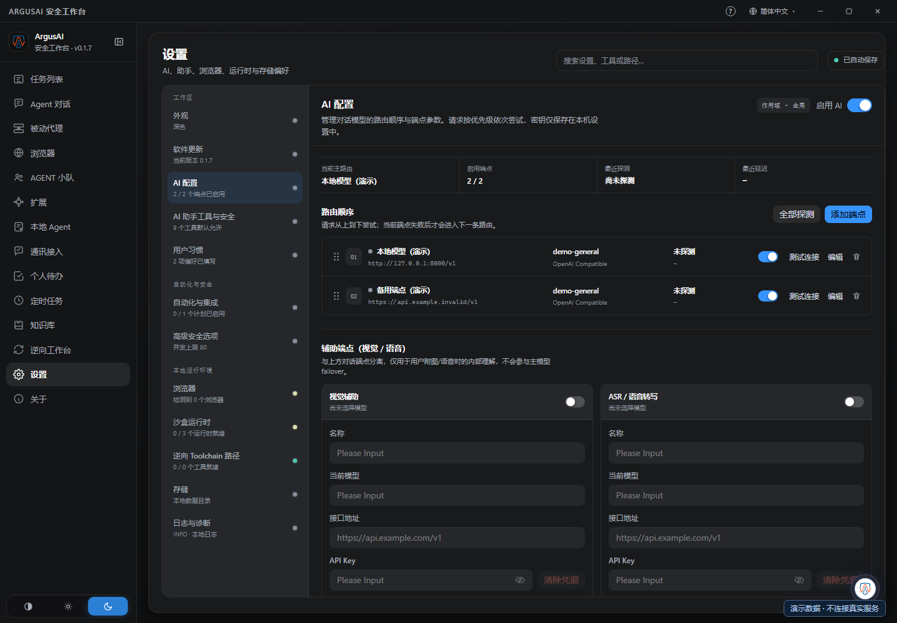
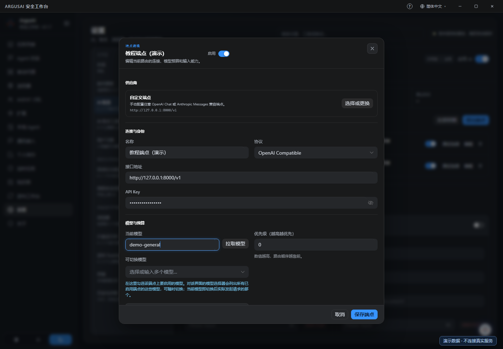
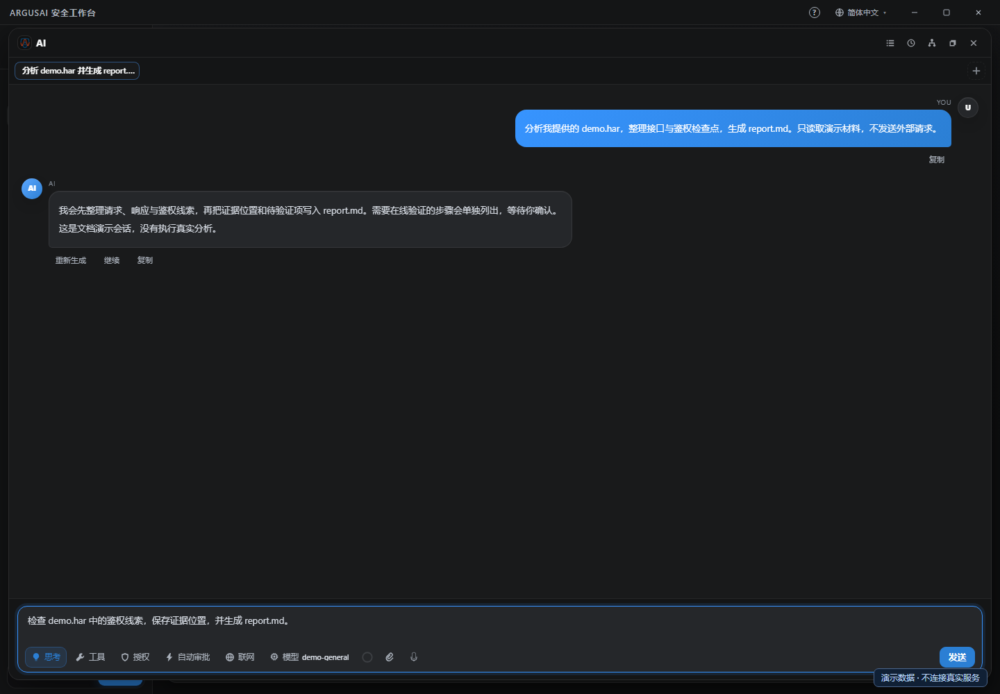
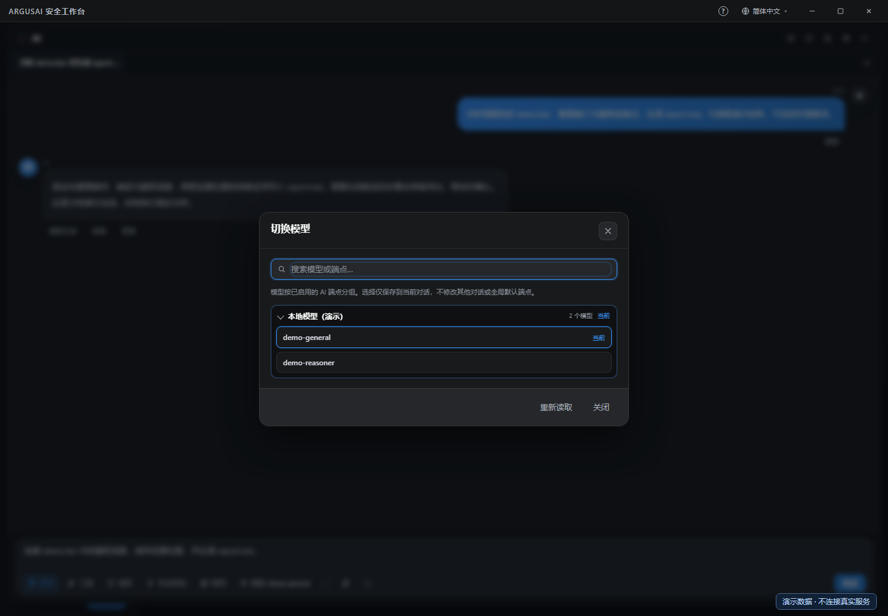
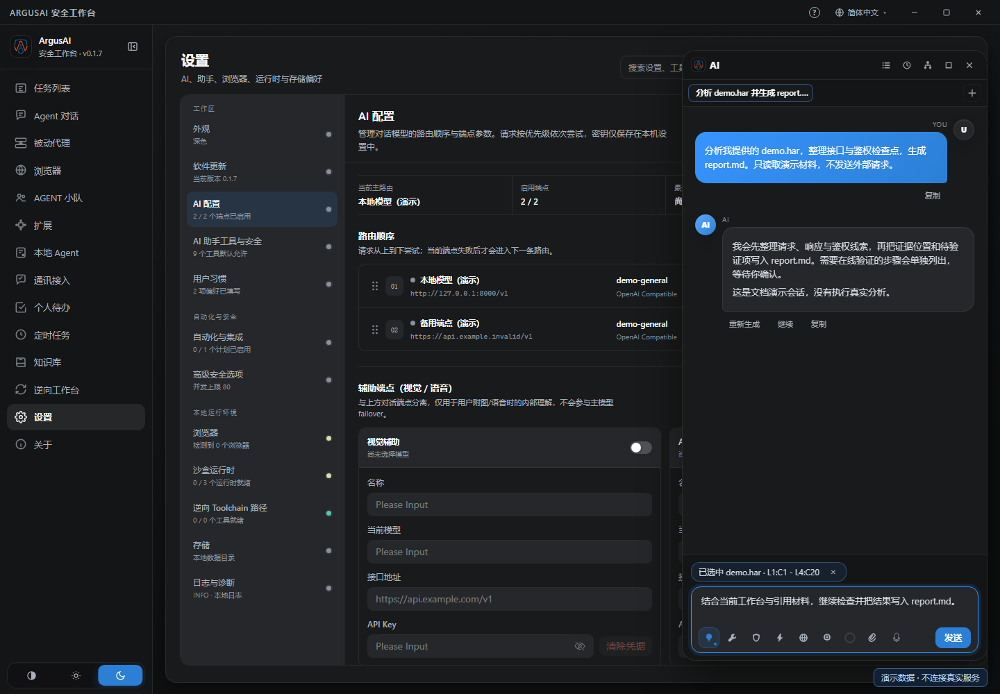
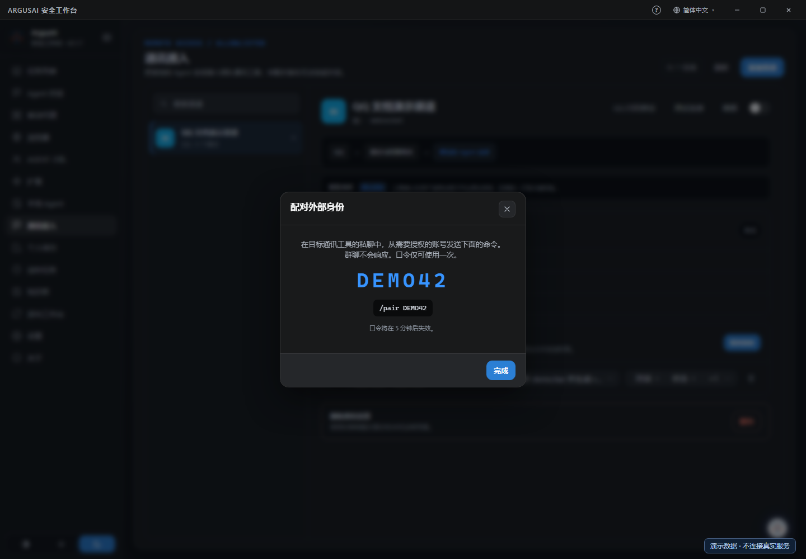
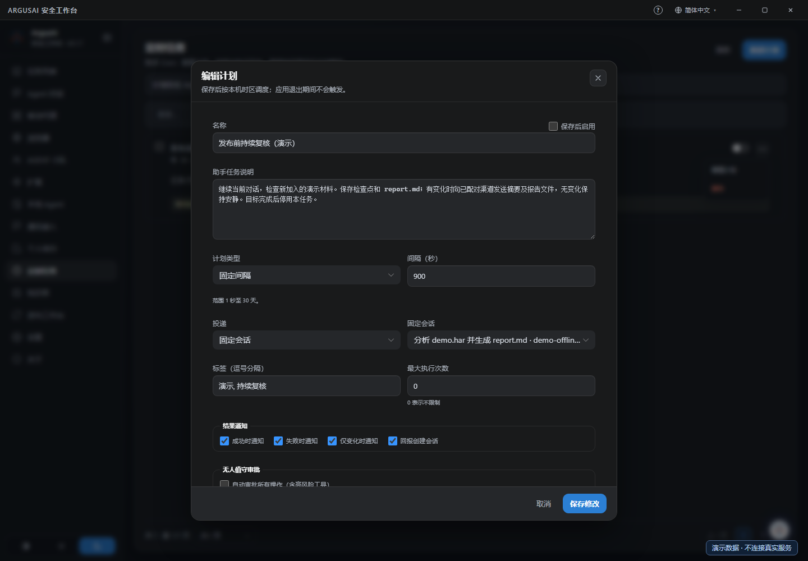

# 桌面图文入门

[文档首页](Home.md) · [安装](Installation.md) · [快速开始](Quick-Start.md) · [Agent 与会话](Agent-and-Sessions.md)

先配置一个可用模型，再把目标和材料交给 Agent。你可以在侧栏管理会话，也可以留在扫描、代理、逆向等工作页面，通过悬浮球继续同一个任务。

本页截图由真实 Vue 界面渲染，使用独立的演示数据。`demo-general`、`demo.har`、`report.md`、接收者和配对码均为虚构；截图环境没有连接模型服务、登录渠道或执行定时任务。图中 `sk-demo-not-real` 仅作占位并已遮盖，不能用于实际请求。

## 1. 启动桌面窗口

安装预编译发行包后，从桌面入口打开，或执行：

```sh
argusai --gui
```

未配置 PATH 的 Windows 用户可从安装目录执行 `.\ArgusAI.exe --gui`；Linux 解压目录使用 `./ArgusAI --gui`。交互终端中裸 `argusai` 默认进入控制台。安装、系统依赖和更新方式见[安装指南](Installation.md)。

首次使用先完成模型配置。ArgusAI 不会随安装包附带可直接使用的大模型；你可以连接自己的本地模型、企业内网端点或云端模型服务。

## 2. 添加全局模型端点

在左侧点击 **设置**，再选择工作区下的 **AI 配置**。这里管理可供对话选择的端点、路由顺序和默认模型。



### 填写连接参数

1. 点击 **添加端点**。
2. 在供应商列表中选对应服务；使用本地或企业网关时，可选 **自定义端点**。
3. 填写 **名称**、**协议**、**接口地址** 和服务要求的 **API 密钥**（界面显示为 **API Key**）。
4. 填写 **当前模型**，或点击 **拉取模型** 后选择服务实际提供的模型。
5. 在 **可切换模型** 中勾选希望在聊天里使用的其他模型。
6. 核对预算和超时，再点击 **保存端点**，等待设置页显示 **已自动保存**。



| 字段 | 应填什么 |
| --- | --- |
| 名称 | 便于区分用途的名称，如“内网模型”或“审计备用端点” |
| 协议 | 服务实际支持的 OpenAI Compatible 或 Anthropic 协议 |
| 接口地址 | 提供者要求的 API 基址，不是聊天网站的网址 |
| API 密钥（API Key） | 提供者发放的凭据；不需要凭据的本地服务按其要求配置 |
| 当前模型 | 精确的模型 ID，不能把界面上的产品名称当成模型标识 |
| 可切换模型 | 该端点上准备开放给会话选择器的模型集合 |
| 优先级 | 数值越高越靠前，界面路由列表也显示实际尝试顺序 |

截图的 `http://127.0.0.1:8000/v1` 只有在本机确实运行兼容服务时才可用。`https://api.example.invalid/v1` 是故意不可用的演示地址。实际配置请替换为自己的服务地址和真实模型 ID。

最大输出限制单次回复长度，上下文窗口用于会话预算。按模型提供者的真实上限设置，不能通过填写更大的数字扩展模型能力。长任务还受工具、运行预算和服务超时影响。

### 默认模型、可切换模型和探测有什么区别

| 操作 | 改变什么 | 不代表什么 |
| --- | --- | --- |
| 修改端点的当前模型或路由顺序 | 修改全局默认连接配置 | 不会把已有会话的独立模型选择批量改掉 |
| 配置可切换模型 | 决定聊天选择器能看到哪些候选模型 | 不保证候选模型都能响应请求 |
| 拉取模型 | 获取或补充端点模型列表；部分服务还会检测输入能力 | 不等于完整审计任务已经通过验证 |
| 测试连接 / 全部探测 | 使用当前参数验证端点能否响应测试 | 不保证长上下文、工具调用或全部多模态能力可用 |
| 在聊天中切换模型 | 选择当前对话使用的模型 | 不修改其他对话的模型选择 |

真实连接测试会访问配置的模型服务，可能产生服务侧用量。截图保留“未探测”状态，没有用演示数据伪装实际连通结果。

如果测试失败，先检查协议、API 基址、模型 ID、凭据和网络，再看服务返回的错误。不要把错误详情中的凭据粘贴到公开讨论区。视觉辅助和 ASR 辅助端点位于同页下方，与主对话模型分别配置。

## 3. 开始第一段 Agent 对话

完成端点配置后，点击侧栏 **Agent 对话 → 新建对话**。也可以点击右下角悬浮球，在顶部标签栏点击 **+**。需要更大的操作空间时，点击对话面板右上方的 **最大化助手**。

使用原生助手时选择 ArgusAI 运行时。需要接入本地 ACP Agent 时，先按[集成指南](Integrations.md#使用本地-acp-agent)配置并验证该运行时，再新建相应对话。选择工作目录前确认目录内容，运行时和工作区绑定在首次发送后会锁定；更换运行时应新建对话。



第一次可以准备一份去掉 Cookie、令牌和个人数据的演示材料，通过附件按钮或拖入展开后的输入区提供，然后发送：

```text
只分析我提供的 demo.har，不发送网络请求，不修改项目代码。
整理接口、鉴权线索和待补充的信息；每项结论标明证据位置。
把结果保存为会话沙盒中的 report.md，并告诉我保存位置。
证据不足的地方写成待验证项，不直接认定为漏洞。
```

观察 Agent 的工具步骤、确认卡片和结果。需要补充材料时直接在同一会话继续；新任务可用新标签页，避免把不相关的材料混入一个上下文。

聊天文字中的“已保存”不是文件凭据。任务结束后，打开该会话的沙盒，核对 `report.md` 确实存在并能读取，再决定是否导出或回传。

## 4. 当前会话的模型、思考和审批

输入框下方的控制项跟随当前对话。切换标签页时，先看当前标签名称和模型，避免在另一个会话继续发任务。



| 控制项 | 用法与范围 |
| --- | --- |
| 模型 | 点击后按端点查找并选择模型；选择跟随当前对话 |
| 思考 | 开关及强度作用于当前对话，是否支持取决于实际模型和端点 |
| 工具 | 查看当前可用工具及授权设置，领域工具可按需发现 |
| 授权 | 核对当前任务的工作范围和授权约定 |
| 自动审批 | 当前会话的工具审批策略；首次使用可保留逐次确认 |
| 联网 | 控制当前会话的网页搜索选项，不能替代全部工具的授权与目标范围 |

全局 **设置 → AI 助手工具与安全** 中的默认值用于初始化新对话。**设置 → 用户习惯** 的表达、输出等偏好则是全局偏好，桌面对话和渠道对话都会使用；它与当前会话的模型、思考和审批不是同一种设置。

自动审批不能替代对目标和动作的判断。遇到需要额外授权的操作，阅读工具名称、参数、影响范围和确认内容，再作决定。收起对话面板不会自动取消正在进行的任务，停止工作应使用对话内的停止操作。

更多会话管理、上下文编辑、导入导出和小队操作见[Agent 与会话](Agent-and-Sessions.md)。

## 5. 在工作页面用悬浮球继续

悬浮球默认位于右下方，可以拖动；在应用窗口中按 `Ctrl+Shift+A` 展开或收起。它与 **Agent 对话** 使用同一套会话，适合保持工作页面可见，同时让 Agent 协助处理当前任务。



你可以在任务详情、代理、浏览器或逆向工作台上直接交代目标，例如：

```text
读取我正在查看的任务和已有证据，梳理下一步。
在当前授权范围内继续验证，把证据位置、结论和待办保存到该任务。
完成后生成报告，说明哪些结论已验证、哪些仍需补充材料。
```

发送时会带入当前应用页面、任务标识及可用工作状态，Agent 再通过工具读取详情。分析某条代理流量时，主动补充流量编号或方法与 URL；当前选中的流量行不保证自动成为消息材料。

文件可从会话沙盒拖到悬浮球上引用，文件选区问答也可转入对话。引用后先检查输入框上方的文件名与行范围；不需要的引用可点 **×** 移除。图片可粘贴到展开的输入区。

这里的“看见当前操作”指应用提供的页面与工作状态，以及主动引用的材料。悬浮球不会持续抓取整个桌面画面；需要浏览器或桌面操作时，使用相应工具和授权流程。

## 6. 配对通讯渠道

模型配置完成后，再配置远端入口。侧栏 **通讯接入** 管理渠道、配对身份和可访问的会话。以 QQ 为例，机器人扫码绑定与远端身份配对是两个步骤。

1. 点击 **添加渠道**，选择 QQ 或需要的提供商。
2. 填写提供商所需参数；QQ 可按界面的 **QQ 扫码绑定** 完成机器人凭据配置。
3. 开启该渠道，点击 **测试连接** 并检查在线状态和错误。确认机器人已经可用后，再生成配对码。
4. 点击 **配对身份**，在与机器人的一对一私聊中发送界面给出的 `/pair 口令`。
5. 回到本机，核对新增身份、聊天标识和绑定的 Agent 对话。
6. 只开启需要的权限；先发送一个简单问题，确认回复落在正确的身份与会话中。



截图中的 QQ 渠道处于关闭状态，`DEMO42` 不是真实配对码，没有账号登录或消息发送。实际使用时，请以界面新生成的短时口令为准。群聊、频道和房间消息不作为身份配对入口。

远端身份的对话、状态、取消、普通确认、配置及发送权限分别控制。QQ、飞书、Telegram 等平台的流式文本、交互卡片和文件能力各有差异；敏感授权可能仍需回到本机处理。

提供商准备、QQ 扫码、CLI 配对与各平台差异见[配对通信渠道](Integrations.md#配对通信渠道)。

## 7. 定时唤醒固定对话

先建立一个已经明确目标和材料的 Agent 会话，再打开侧栏 **定时任务 → 新建计划**。想继续同一个调查或开发任务时，在 **投递** 中选择 **固定会话**，并在右侧明确选中对应会话。



图中是已经填好但未启用的演示计划。创建或编辑时依次核对：

| 项目 | 示例 |
| --- | --- |
| 名称 | 发布前持续复核 |
| 触发类型 | 固定间隔；示例为 `900` 秒，即 15 分钟 |
| 投递 | 固定会话，选择需要续跑的会话 |
| 助手任务说明 | 目标、材料位置、允许动作、检查点、交付物和停止条件 |
| 通知 | 有变化时报告，失败通知；是否回送创建会话按实际需要选择 |
| 保存后启用 | 先保存核对，确认运行约定后再开启 |

可以使用下面的任务约定，并替换材料范围：

```text
继续当前对话的材料分析，只处理新加入的演示文件。
读取上次检查点，完成一批有界工作后更新检查点和 report.md。
有变化时向已配对且允许发送的身份回传摘要和报告文件；无变化保持安静。
遇到需要额外确认的操作时等待我处理，不自行扩大范围。
达到约定目标后停用这项计划，并通知最终结果与文件位置。
```

四种触发类型可分别选择固定间隔、Cron、签名 Webhook 和文件变化。运行方式则分别为每次新建会话、任务专属会话和固定会话；它们控制的是上下文关系，和触发器相互独立。

每次新建会话不会复制创建者完整历史。固定会话保留已有上下文；任务专属会话适合让巡检独立积累记录。目标会话忙时任务会延后，超出等待期限可能跳过本次触发。查看运行记录和实际执行会话，不要把单轮完成当成长目标已经结束。

调度需要桌面宿主或无界面托管宿主保持运行。四类触发器、次数限制、常驻方式和停止操作见[自动化](Automation.md)。

## 8. 让任务回传摘要和文件

渠道接通并绑定会话后，在任务提示中说明交付对象和交付物。只说“告诉我结果”可能只得到摘要；需要实际文件时应明确格式、文件名和接收身份。

```text
完成后先确认会话沙盒中的 report.md 存在且可读取。
向当前已配对的接收身份发送简短结论，再发送 report.md 文件。
检查投递状态；失败时保留文件并报告具体原因，不把入队当成已送达。
```

Agent 可使用 `channel_send_message` 和 `channel_send_file` 提交主动通知与文件，并通过 `channel_delivery_status` 查看队列结果。普通渠道聊天的回复由 `channel_reply` 处理，模型决定消息分段。

文件从会话沙盒读取，需满足软件和平台的大小、格式限制。报告来自扫描或逆向工作区时，应先准备为可发送文件并保留原始证据引用。队列接受、平台发送成功和对方已读是不同状态；发送失败时检查投递记录中的平台错误。

完整交付示例见[任务完成后回传结果和文件](Integrations.md#任务完成后回传结果和文件)。

## 9. 首次使用的检查顺序

| 现象 | 先检查 |
| --- | --- |
| 只有控制台，没有桌面窗口 | 使用 `argusai --gui`；再检查系统图形依赖 |
| 模型列表为空 | 端点是否启用，是否填写当前模型或可切换模型 |
| 测试连接失败 | 协议、基址、模型 ID、凭据、网络与服务返回错误 |
| 新对话没有预期模型 | 核对全局默认路由，再核对当前会话选择 |
| 文件“已保存”却找不到 | 打开同一个会话的沙盒，核对实际文件与路径 |
| 远端不能对话 | 渠道在线状态、一次性配对、身份绑定及权限 |
| 定时任务没有继续 | 是否启用、宿主是否运行、目标会话是否忙、运行记录是否有错误或跳过 |
| 报告没有收到 | 文件是否存在、身份是否允许发送，以及最终投递状态 |

继续使用：[Web 审计与代理](Web-Audit-and-Proxy.md) · [逆向工作台](Reverse-Workbench.md) · [企业工作流](Enterprise-Workflows.md) · [故障排查](Troubleshooting.md)
